<h1 align="center">IAM PowerShell Automation Project</h1>

  
  
  

  
  
  
  
  
  

An eight-day lab for learning PowerShell through identity and access management in Active Directory Domain Services on VMware and Microsoft Entra ID. The Day 01 tenant overview displays Microsoft Entra ID P2.

**Status** · All eight labs documented with seventy-nine screenshots, working AD lifecycle automation and successful CI: 44 Pester tests plus a separate 50-check offline runner.

## Project overview

The first labs build skills with PowerShell pipelines, domain accounts, security groups and Microsoft Graph. The capstone combines the AD exercises into a Joiner–Mover–Leaver workflow driven by synthetic HR events. The recorded Day 07 workflow previews changes, applies them in the isolated JML OU and verifies account/group state independently. Day 08 verified fresh SMB access, disabled-account sign-in rejection, repeated events, live partial-failure recovery and an outside-OU rejection with unchanged target state.

Days 04 and 05 use separate cloud-only test identities. Day 06 uses the existing Microsoft Entra Cloud Sync agent for a dedicated AD test user, diagnoses a scope issue, compares its source anchor and verifies a department change through Graph. The recorded synchronization requests were run on demand.

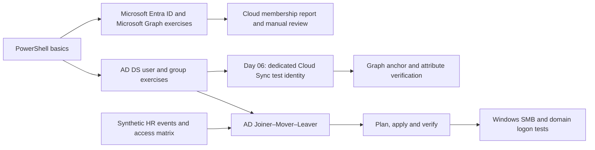

## Quick Lab Index

| Day | Milestone | Documentation | Tests | Evidence | Status |
| --- | --- | --- | --- | --- | --- |
| 01 | Lab setup and PowerShell basics | [Record](docs/day-01.md) | [Tests](tests/day-01.md) | [Evidence](evidence/day-01/README.md) | Documented |
| 02 | Active Directory user management | [Record](docs/day-02.md) | [Tests](tests/day-02.md) | [Evidence](evidence/day-02/README.md) | Documented |
| 03 | Active Directory groups and effective access | [Record](docs/day-03.md) | [Tests](tests/day-03.md) | [Evidence](evidence/day-03/README.md) | Documented |
| 04 | Entra ID user management with Microsoft Graph | [Record](docs/day-04.md) | [Tests](tests/day-04.md) | [Evidence](evidence/day-04/README.md) | Documented |
| 05 | Entra security groups and manual access review | [Record](docs/day-05.md) | [Tests](tests/day-05.md) | [Evidence](evidence/day-05/README.md) | Documented |
| 06 | Scoped Cloud Sync, source anchor and attribute propagation | [Record](docs/day-06.md) | [Tests](tests/day-06.md) | [Evidence](evidence/day-06/README.md) | Documented |
| 07 | Build the Joiner–Mover–Leaver automation | [Record](docs/day-07.md) | [Tests](tests/day-07.md) | [Evidence](evidence/day-07/README.md) | Documented |
| 08 | Capstone, Pester and portfolio review | [Record](docs/day-08.md) | [Tests](tests/day-08.md) | [Evidence](evidence/day-08/README.md) | Documented |

## Repository guide

- [Architecture and lab prerequisites](docs/architecture.md)
- [Permissions and lab boundaries](docs/permissions.md)
- [Recovery runbook](docs/recovery-runbook.md)
- [PowerShell examples and lifecycle usage](scripts/README.md)
- [AD lifecycle entry point](scripts/Invoke-IamLifecycle.ps1) and [module](src/IamAutomation/IamAutomation.psm1)
- [Pester lifecycle tests](tests/unit/Lifecycle.Tests.ps1) and [test instructions](tests/unit/README.md)
- [Separate offline lifecycle checks](tests/offline/Lifecycle.Checks.ps1)
- [Day 08 capstone events](samples/hr-events.day08.example.csv) and [scope-test event](samples/hr-events.out-of-scope.example.csv)
- [Recorded CI result](evidence/day-08/ci-summary.md)
- [Example access policy](config/access-matrix.example.json)
- [Synthetic HR events](samples/hr-events.example.csv)
- [Day 05 membership review report](samples/membership-review.csv) and [final-state report](samples/membership-after.csv)
- [Evidence guide](evidence/README.md)

## Featured evidence

The evidence from Days 01–08 connects directory fundamentals to a tested AD lifecycle: real access changes, controlled recovery, scope rejection, new-sign-in denial and automated regression checks.

<table>
<tr>
<td width="50%" align="center" valign="top">
  <a href="evidence/day-01/README.md">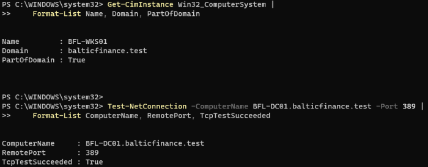</a> 
  <strong>Domain connectivity</strong> 
  BFL-WKS01 membership and TCP 389 reachability
</td>
<td width="50%" align="center" valign="top">
  <a href="evidence/day-01/README.md">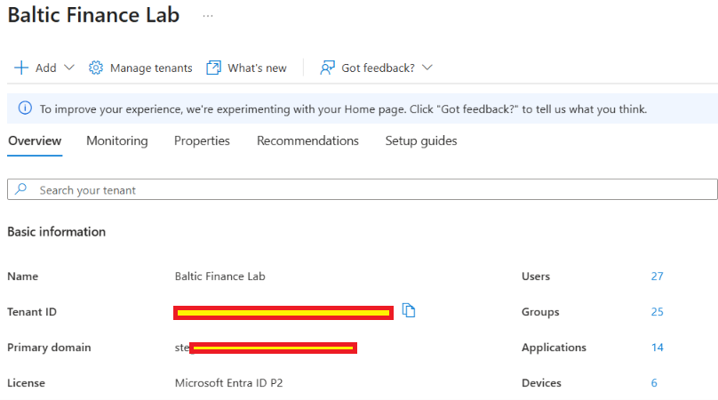</a> 
  <strong>Microsoft Entra ID P2</strong> 
  Recorded tenant overview with redacted identifiers
</td>
</tr>
<tr>
<td width="50%" align="center" valign="top">
  <a href="evidence/day-01/README.md">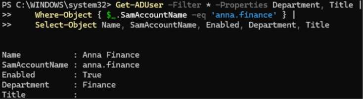</a> 
  <strong>PowerShell pipeline</strong> 
  Filtered AD account and selected properties
</td>
<td width="50%" align="center" valign="top">
  <a href="evidence/day-01/README.md">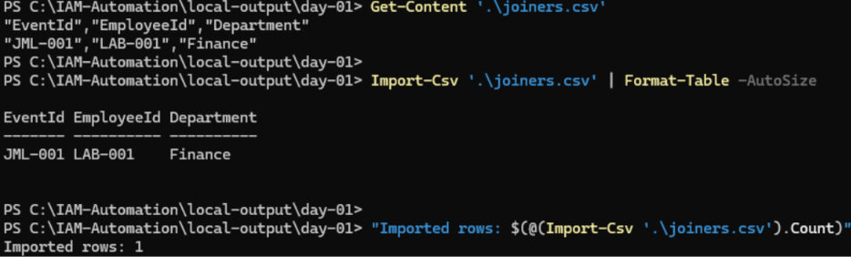</a> 
  <strong>Synthetic CSV validation</strong> 
  File content and one-record reimport
</td>
</tr>
<tr>
<td width="50%" align="center" valign="top">
  <a href="evidence/day-02/README.md">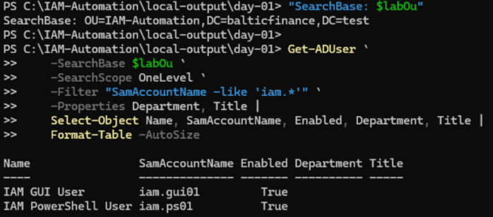</a> 
  <strong>Scoped AD user query</strong> 
  Two test accounts read from IAM-Automation
</td>
<td width="50%" align="center" valign="top">
  <a href="evidence/day-02/README.md">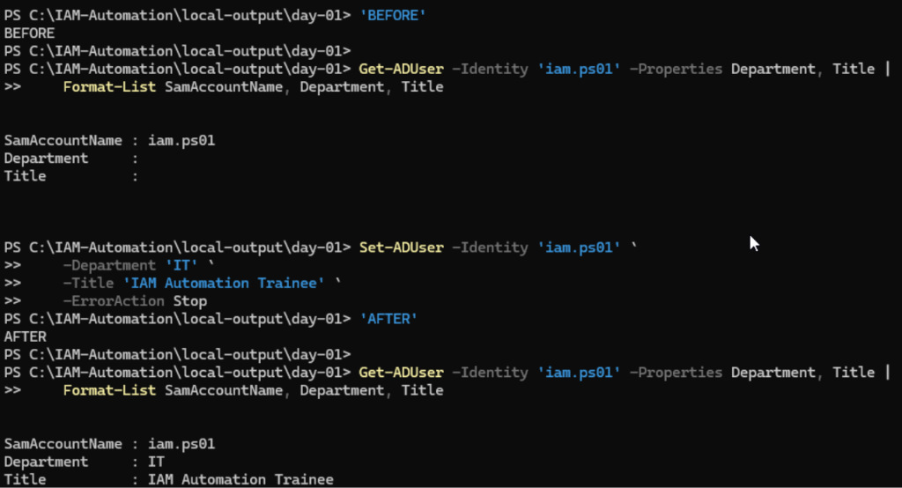</a> 
  <strong>Attribute update and verification</strong> 
  Department and Title read before and after the change
</td>
</tr>
<tr>
<td width="50%" align="center" valign="top">
  <a href="evidence/day-03/README.md">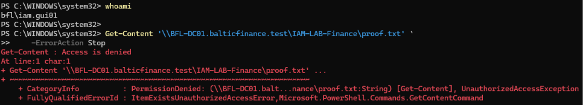</a> 
  <strong>Finance access revoked</strong> 
  The same proof-file path returns Access is denied
</td>
<td width="50%" align="center" valign="top">
  <a href="evidence/day-03/README.md">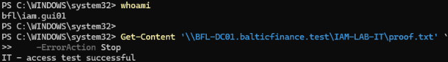</a> 
  <strong>IT access verified</strong> 
  The transferred test identity reads its new department file
</td>
</tr>
<tr>
<td width="50%" align="center" valign="top">
  <a href="evidence/day-04/README.md">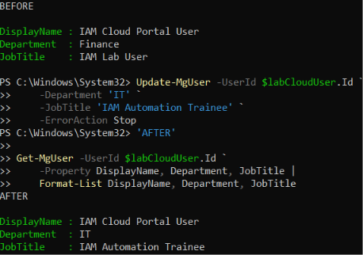</a> 
  <strong>Graph attribute update</strong> 
  Department and JobTitle verified through independent reads
</td>
<td width="50%" align="center" valign="top">
  <a href="evidence/day-04/README.md">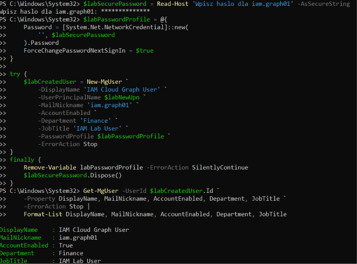</a> 
  <strong>Graph user creation</strong> 
  New-MgUser followed by account read-back
</td>
</tr>
<tr>
<td width="50%" align="center" valign="top">
  <a href="evidence/day-05/README.md">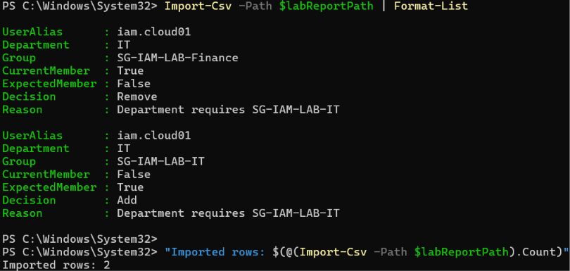</a> 
  <strong>Membership review decision</strong> 
  Expected access, observed memberships and the reason for correction
</td>
<td width="50%" align="center" valign="top">
  <a href="evidence/day-05/README.md">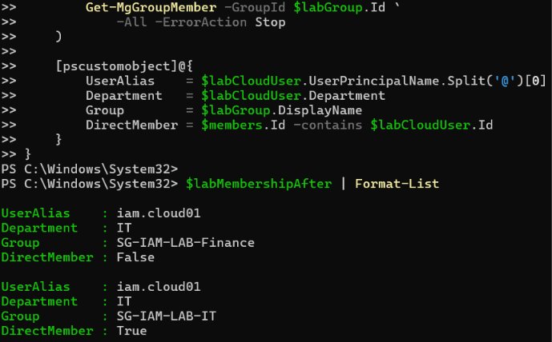</a> 
  <strong>Correction verified</strong> 
  Fresh reads confirm the intended direct memberships
</td>
</tr>
<tr>
<td width="50%" align="center" valign="top">
  <a href="evidence/day-06/README.md">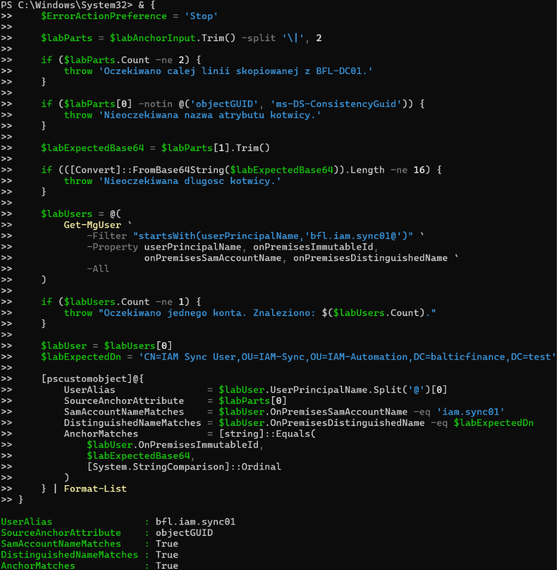</a> 
  <strong>Hybrid identity correlation</strong> 
  AD source anchor compared with Graph onPremisesImmutableId
</td>
<td width="50%" align="center" valign="top">
  <a href="evidence/day-06/README.md">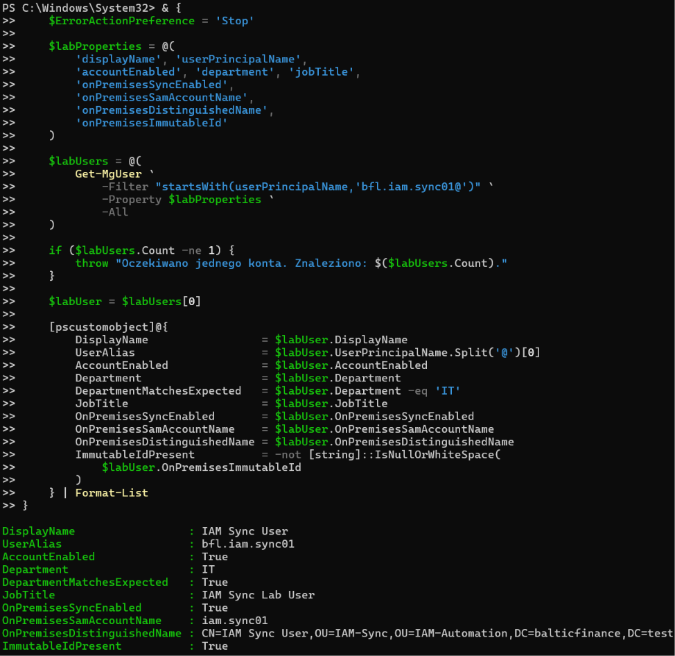</a> 
  <strong>Department propagation verified</strong> 
  Finance → IT confirmed after an on-demand Cloud Sync update
</td>
</tr>
<tr>
<td width="50%" align="center" valign="top">
  <a href="evidence/day-07/README.md">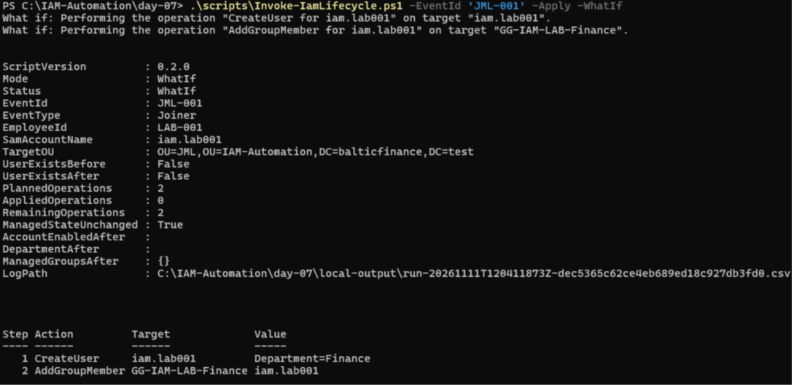</a> 
  <strong>Lifecycle WhatIf</strong> 
  Two planned operations, zero applied and unchanged AD state
</td>
<td width="50%" align="center" valign="top">
  <a href="evidence/day-07/README.md">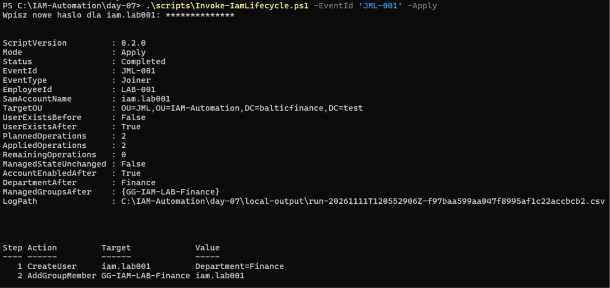</a> 
  <strong>Joiner completed</strong> 
  Account creation and Finance grant verified after Apply
</td>
</tr>
<tr>
<td width="50%" align="center" valign="top">
  <a href="evidence/day-07/README.md">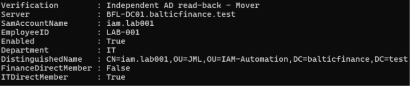</a> 
  <strong>Mover independently verified</strong> 
  Department IT, Finance=False and IT=True
</td>
<td width="50%" align="center" valign="top">
  <a href="evidence/day-07/README.md">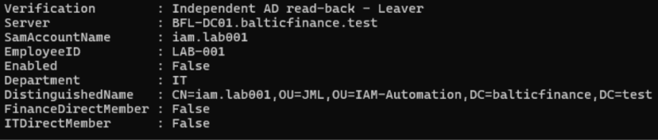</a> 
  <strong>Leaver independently verified</strong> 
  Account disabled and both managed memberships absent
</td>
</tr>
<tr>
<td width="50%" align="center" valign="top">
  <a href="evidence/day-08/README.md">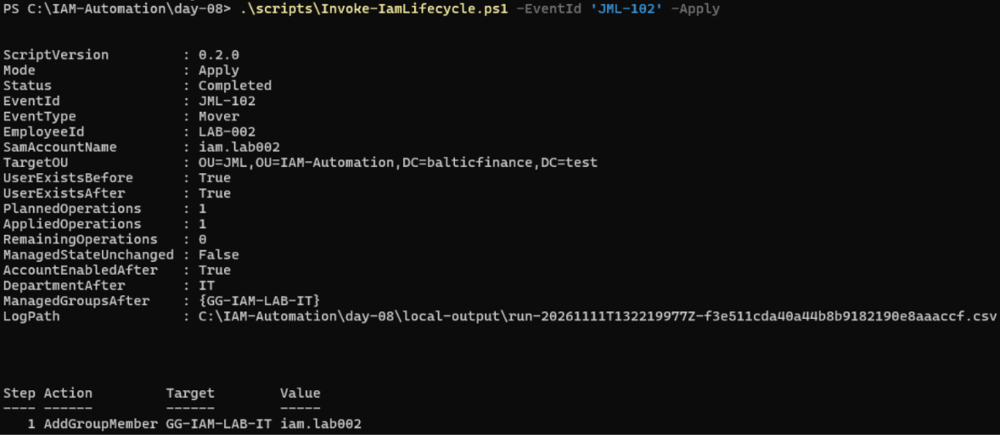</a> 
  <strong>Partial Mover recovered</strong> 
  Fresh plan and Apply complete only the missing IT grant
</td>
<td width="50%" align="center" valign="top">
  <a href="evidence/day-08/README.md">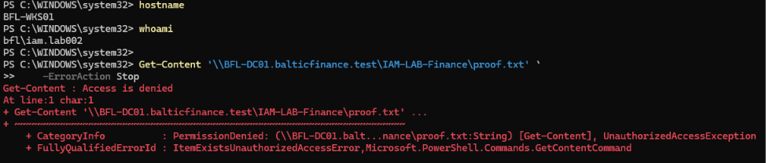</a> 
  <strong>Old access denied</strong> 
  Fresh client session returns Finance PermissionDenied
</td>
</tr>
<tr>
<td width="50%" align="center" valign="top">
  <a href="evidence/day-08/README.md">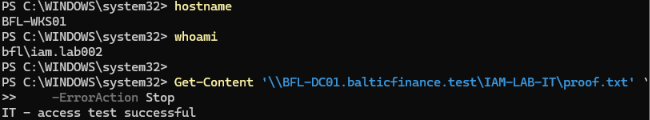</a> 
  <strong>New access confirmed</strong> 
  The same user reads the IT proof file
</td>
<td width="50%" align="center" valign="top">
  <a href="evidence/day-08/README.md">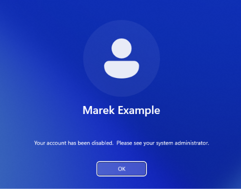</a> 
  <strong>Disabled-account sign-in rejected</strong> 
  Windows refuses the new sign-in after Leaver
</td>
</tr>
<tr>
<td width="50%" align="center" valign="top">
  <a href="evidence/day-08/README.md">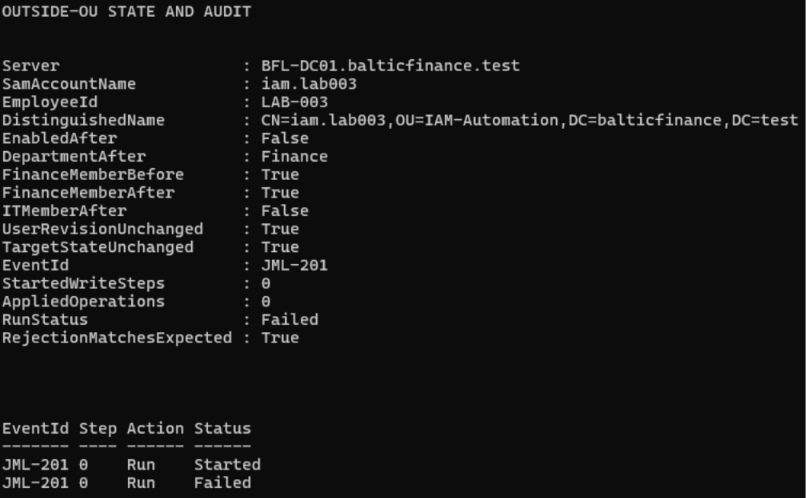</a> 
  <strong>OU boundary enforced</strong> 
  Expected rejection with unchanged target state and zero write steps
</td>
<td width="50%" align="center" valign="top">
  <a href="evidence/day-08/README.md">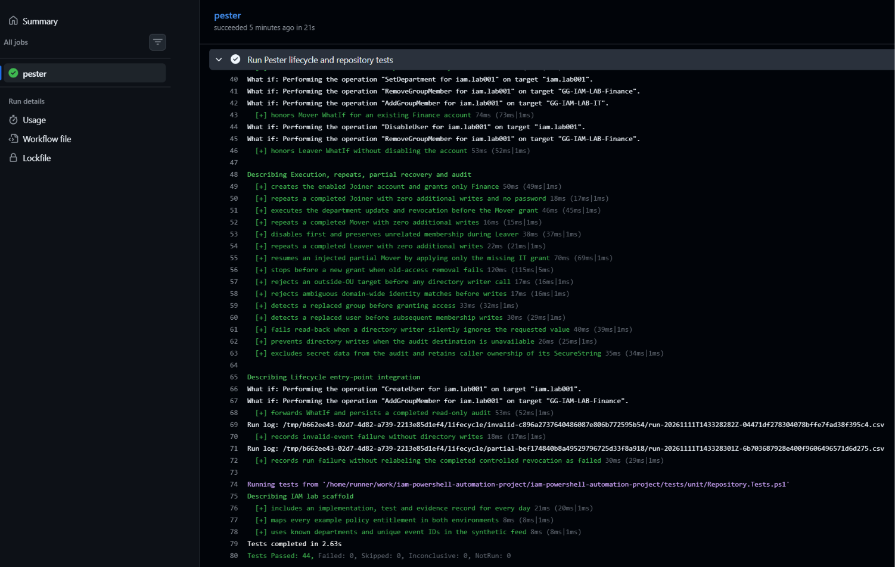</a> 
  <strong>44 Pester tests passed</strong> 
  Successful GitHub Actions job with detailed lifecycle results
</td>
</tr>
</table>

## Related labs

- [Microsoft Entra Identity & Access Project](https://github.com/krzysztof-szot/entra-identity-access-project)
- [Hybrid Enterprise Security Project](https://github.com/krzysztof-szot/hybrid-enterprise-security-project)
