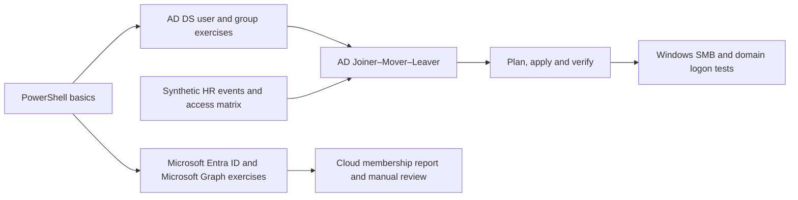

<h1 align="center">IAM PowerShell Automation Project</h1>

  
  

  
  
  
  
  
  

An eight-day lab for learning PowerShell through identity and access management in Active Directory Domain Services on VMware and Microsoft Entra ID. The Day 01 tenant overview displays Microsoft Entra ID P2.

**Status** · Days 01–02 documented with seven screenshots and an AD attribute script. Days 03–08 are planned.

## Project overview

The first labs build skills with PowerShell pipelines, domain accounts, security groups and Microsoft Graph. The capstone combines the AD exercises into a Joiner–Mover–Leaver workflow driven by synthetic HR events. It previews proposed changes, applies them within the lab scope and verifies the outcome through SMB access and a fresh domain logon attempt.

The Entra labs use separate cloud-only test identities. Day 06 offers either an isolated Entra Connect Sync exercise or an access drift report for both directories.

## Quick Lab Index

| Day | Milestone | Documentation | Tests | Evidence | Status |
| --- | --- | --- | --- | --- | --- |
| 01 | Lab setup and PowerShell basics | [Record](docs/day-01.md) | [Tests](tests/day-01.md) | [Evidence](evidence/day-01/README.md) | Documented |
| 02 | Active Directory user management | [Record](docs/day-02.md) | [Tests](tests/day-02.md) | [Evidence](evidence/day-02/README.md) | Documented |
| 03 | Active Directory groups and effective access | [Plan](docs/day-03.md) | [Tests](tests/day-03.md) | [Evidence](evidence/day-03/README.md) | Planned |
| 04 | Entra ID user management with Microsoft Graph | [Plan](docs/day-04.md) | [Tests](tests/day-04.md) | [Evidence](evidence/day-04/README.md) | Planned |
| 05 | Entra security groups and manual access review | [Plan](docs/day-05.md) | [Tests](tests/day-05.md) | [Evidence](evidence/day-05/README.md) | Planned |
| 06 | Optional AD-to-Entra synchronization or access drift report | [Plan](docs/day-06.md) | [Tests](tests/day-06.md) | [Evidence](evidence/day-06/README.md) | Planned |
| 07 | Build the Joiner–Mover–Leaver automation | [Plan](docs/day-07.md) | [Tests](tests/day-07.md) | [Evidence](evidence/day-07/README.md) | Planned |
| 08 | Capstone, Pester and portfolio review | [Plan](docs/day-08.md) | [Tests](tests/day-08.md) | [Evidence](evidence/day-08/README.md) | Planned |

## Repository guide

- [Architecture and lab prerequisites](docs/architecture.md)
- [Permissions and lab boundaries](docs/permissions.md)
- [Recovery runbook](docs/recovery-runbook.md)
- [PowerShell examples and planned entry points](scripts/README.md)
- [Example access policy](config/access-matrix.example.json)
- [Synthetic HR events](samples/hr-events.example.csv)
- [Evidence guide](evidence/README.md)

## Featured evidence

The evidence from Days 01–02 connects the lab environment to recorded account queries, attribute changes and CSV results.

<table>
<tr>
<td width="50%" align="center" valign="top">
   
  <strong>Domain connectivity</strong> 
  BFL-WKS01 membership and TCP 389 reachability
</td>
<td width="50%" align="center" valign="top">
   
  <strong>Microsoft Entra ID P2</strong> 
  Recorded tenant overview with redacted identifiers
</td>
</tr>
<tr>
<td width="50%" align="center" valign="top">
   
  <strong>PowerShell pipeline</strong> 
  Filtered AD account and selected properties
</td>
<td width="50%" align="center" valign="top">
   
  <strong>Synthetic CSV validation</strong> 
  File content and one-record reimport
</td>
</tr>
<tr>
<td width="50%" align="center" valign="top">
   
  <strong>Scoped AD user query</strong> 
  Two test accounts read from IAM-Automation
</td>
<td width="50%" align="center" valign="top">
   
  <strong>Attribute update and verification</strong> 
  Department and Title read before and after the change
</td>
</tr>
</table>

## Related labs

- [Microsoft Entra Identity & Access Project](https://github.com/krzysztof-szot/entra-identity-access-project)
- [Hybrid Enterprise Security Project](https://github.com/krzysztof-szot/hybrid-enterprise-security-project)
