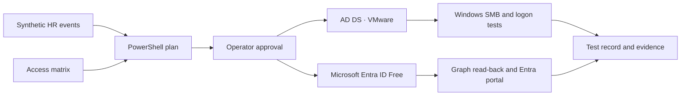

# IAM PowerShell Automation — Baltic Finance Lab

  
  

  
  
  
  
  
  

An eight-day PowerShell lab for automating Joiner, Mover and Leaver events in Active Directory Domain Services and Microsoft Entra ID Free. AD DS on VMware is the primary environment. The Entra exercise uses separate cloud-only test identities.

**Status** · Repository scaffold. Implementation, lab results and screenshots are pending.

## Project overview

A synthetic HR event and a shared access matrix drive a preview of proposed account and membership changes. After explicit approval, the planned workflow applies only scoped changes, reads back the result and records evidence. The domain exercise verifies effective access to Finance and IT SMB shares from Windows.

## Quick Lab Index

| Day | Milestone | Implementation plan | Test cases | Screenshot checklist |
| --- | --- | --- | --- | --- |
| 01 | Foundation and read-only planning | [Plan](docs/day-01.md) | [Tests](tests/day-01.md) | [Evidence](evidence/day-01/README.md) |
| 02 | Joiner in Active Directory | [Plan](docs/day-02.md) | [Tests](tests/day-02.md) | [Evidence](evidence/day-02/README.md) |
| 03 | Mover in Active Directory | [Plan](docs/day-03.md) | [Tests](tests/day-03.md) | [Evidence](evidence/day-03/README.md) |
| 04 | Leaver in Active Directory | [Plan](docs/day-04.md) | [Tests](tests/day-04.md) | [Evidence](evidence/day-04/README.md) |
| 05 | Cloud-only lifecycle in Entra ID Free | [Plan](docs/day-05.md) | [Tests](tests/day-05.md) | [Evidence](evidence/day-05/README.md) |
| 06 | Access drift and recovery | [Plan](docs/day-06.md) | [Tests](tests/day-06.md) | [Evidence](evidence/day-06/README.md) |
| 07 | Pester tests and GitHub Actions | [Plan](docs/day-07.md) | [Tests](tests/day-07.md) | [Evidence](evidence/day-07/README.md) |
| 08 | Capstone and publication review | [Plan](docs/day-08.md) | [Tests](tests/day-08.md) | [Evidence](evidence/day-08/README.md) |

## Repository guide

- [Architecture and lab prerequisites](docs/architecture.md)
- [Permissions and lab boundaries](docs/permissions.md)
- [Recovery runbook](docs/recovery-runbook.md)
- [PowerShell entry points](scripts/README.md)
- [Example access policy](config/access-matrix.example.json)
- [Synthetic HR events](samples/hr-events.example.csv)
- [Evidence guide](evidence/README.md)

## Featured evidence

The gallery will link to verified evidence for the read-only plan, the Finance-to-IT access change, recovery after a partial run and the final logon denial.

## Related labs

- [Microsoft Entra Identity & Access Project](https://github.com/krzysztof-szot/entra-identity-access-project)
- [Hybrid Enterprise Security Project](https://github.com/krzysztof-szot/hybrid-enterprise-security-project)
