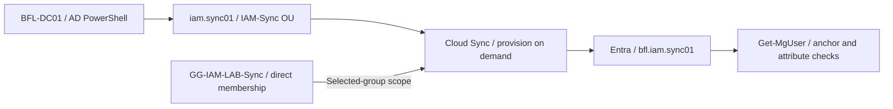

# Architecture

## Environments

| Path | Directory and tools | Validation |
| --- | --- | --- |
| Domain | Existing VMware Windows Server domain controller, ActiveDirectory PowerShell module, domain-connected Windows client | Account and membership read-back, live SMB access, fresh domain authentication and Windows Security log |
| Cloud | Microsoft Entra ID P2 displayed in the Day 01 tenant overview, Microsoft Graph PowerShell with delegated authentication, cloud-only objects for Days 04–05 and an AD-sourced test identity for Day 06 | Graph read-back and Microsoft Entra admin center evidence |

The lab uses an existing VMware domain controller, a Windows client with domain connectivity and a Microsoft Entra tenant. The core user and static-group exercises use capabilities available in Entra ID Free. The recorded Day 01 tenant overview displays Microsoft Entra ID P2. Both directories use the same example policy keys and resolve their own identities and group identifiers. Days 04 and 05 use separate cloud-only test objects. Day 06 uses the existing Microsoft Entra Cloud Sync provisioning agent on BFL-DC01, a dedicated test OU and selected-group scope. Its recorded creation and department-update requests use provision on demand.

## Day 01 recorded environment

| Component | Recorded observation |
| --- | --- |
| Domain client | BFL-WKS01, PartOfDomain=True |
| AD domain | balticfinance.test |
| Controller endpoint | BFL-DC01.balticfinance.test, TCP 389 reachable |
| Entra tenant | Baltic Finance Lab, portal displays Microsoft Entra ID P2 |
| AD test identity | anna.finance, Enabled=True, Department=Finance |
| CSV working directory | `C:\IAM-Automation\local-output\day-01` |

[Day 01 lab record](day-01.md) · [Screenshots](../evidence/day-01/README.md)

## Day 02 recorded AD scope

| Component | Recorded observation |
| --- | --- |
| Dedicated OU | `OU=IAM-Automation,DC=balticfinance,DC=test` |
| First test user | IAM GUI User / iam.gui01, Enabled=True |
| Second test user | IAM PowerShell User / iam.ps01, Enabled=True at the scoped query |
| Attribute update | iam.ps01 Department=IT, Title=IAM Automation Trainee |
| Saved example | scripts/day-02-user-attributes.ps1 |

[Day 02 lab record](day-02.md) · [Screenshots](../evidence/day-02/README.md)

## Day 03 recorded access model

| Component | Recorded observation |
| --- | --- |
| Finance share | IAM-LAB-Finance, department SMB Read and NTFS ReadAndExecute |
| IT share | IAM-LAB-IT, department SMB Read and NTFS ReadAndExecute |
| Lab folders | `C:\LabShares\IAM-Automation\Finance` and `C:\LabShares\IAM-Automation\IT` |
| Transfer identity | iam.gui01, Finance membership before and IT membership after |
| Effective access | Finance proof file readable before transfer, denied afterward. IT proof file readable afterward. |
| Separate account state test | iam.ps01 Enabled=True → False → True |
| Saved example | scripts/day-03-group-memberships.ps1 |

[Day 03 lab record](day-03.md) · [Screenshots](../evidence/day-03/README.md)

## Day 04 recorded cloud identities

| Component | Recorded observation |
| --- | --- |
| Portal-created identity | IAM Cloud Portal User / iam.cloud01, Member |
| Updated attributes | Department=IT, JobTitle=IAM Automation Trainee |
| Graph session | Delegated authentication, Process context, visible account alias bg01 |
| Displayed permissions | User.ReadWrite.All plus the additional scopes recorded in the permissions guide |
| Graph-created identity | IAM Cloud Graph User / iam.graph01, AccountEnabled=True |
| New account attributes | Department=Finance, JobTitle=IAM Lab User |

[Day 04 lab record](day-04.md) · [Screenshots](../evidence/day-04/README.md) · [Graph context](permissions.md#day-04-recorded-graph-context)

## Day 05 recorded membership review

| Component | Recorded observation |
| --- | --- |
| Test identity | IAM Cloud Portal User / iam.cloud01, Department=IT |
| Policy | Finance maps to SG-IAM-LAB-Finance, IT maps to SG-IAM-LAB-IT |
| Controlled initial state | Finance membership present, IT membership absent |
| Review decision | Remove Finance and add IT because Department requires SG-IAM-LAB-IT |
| Final direct memberships | Finance=False, IT=True |
| Reports | [Review snapshot](../samples/membership-review.csv), [final state](../samples/membership-after.csv) |

[Day 05 lab record](day-05.md) · [Screenshots](../evidence/day-05/README.md)

## Day 06 recorded Cloud Sync path

| Component | Recorded observation |
| --- | --- |
| Agent | AADConnectProvisioningAgent Running on BFL-DC01; registered agent active |
| Initial configuration | balticfinance.test Cloud Sync overview shows Disabled |
| Test OU | `OU=IAM-Sync,OU=IAM-Automation,DC=balticfinance,DC=test` |
| Identity | IAM Sync User; AD iam.sync01 and cloud alias bfl.iam.sync01 |
| Scope correction | Global Security group GG-IAM-LAB-Sync contains one direct test member and becomes the fourth selected group |
| Initial skipped request | JoinNotFound with detailed Scoping filter evaluation passed=False |
| Identity correlation | SourceAnchorAttribute=objectGUID; SAM name, DN and Base64 anchor comparisons True |
| Attribute propagation | Department Finance → IT in AD, exported update, fresh Graph Department=IT |
| Recorded mode | Provision on demand; recurring-cycle operation was outside the tests |

[Day 06 lab record](day-06.md) · [Screenshots](../evidence/day-06/README.md) · [Permissions and coverage](permissions.md#day-06-recorded-cloud-sync-operations)

## Day 07 recorded AD lifecycle workflow

1. Validate the input and the lab boundary.
2. Read current state and calculate changes from the access matrix.
3. Preview changes by default and require explicit apply intent. Honor PowerShell `-WhatIf` for write operations.
4. Recheck relevant state, apply scoped changes and record step outcomes.
5. Verify directory state and collect independent access evidence where applicable.

The Day 07 execution uses BFL-DC01, Windows PowerShell 5.1 and the lab administrator. The disposable identity iam.lab001 / LAB-001 lives in OU=JML,OU=IAM-Automation. Only GG-IAM-LAB-Finance and GG-IAM-LAB-IT directly in IAM-Automation are managed. The separate IAM-Sync identity remains outside this workflow.

| Stage | Enabled | Department | Finance direct member | IT direct member | Applied steps |
| --- | --- | --- | --- | --- | --- |
| Joiner | True | Finance | True | False | 2 |
| Mover | True | IT | False | True | 3 |
| Leaver | False | IT | False | False | 2 |

Each stage has an independent AD read and a completed CSV audit view with zero failed records. Sixteen screenshots record the full exercise. Fresh workstation access and authentication checks remain in Day 08.

~~~mermaid
flowchart LR
    CSV["Synthetic HR event"] --> VAL["Validate exact lab scope"]
    CFG["Local config and access matrix"] --> VAL
    VAL --> SNAP["Read AD on configured DC"]
    SNAP --> PLAN["Compute current-state plan"]
    PLAN --> PRE["Default Preview / WhatIf"]
    PLAN --> APPLY["Explicit Apply / ShouldProcess"]
    APPLY --> WRITE["Re-read, bind GUIDs and write"]
    WRITE --> CHECK["Fresh read-back"]
    CHECK --> LOG["Per-step CSV audit"]
    CHECK --> VERIFY["Independent AD verification"]
~~~

Use config/lab.local.json for actual identifiers and local-output/ for logs or exports. [Day 07 record](day-07.md) · [Evidence](../evidence/day-07/README.md)
