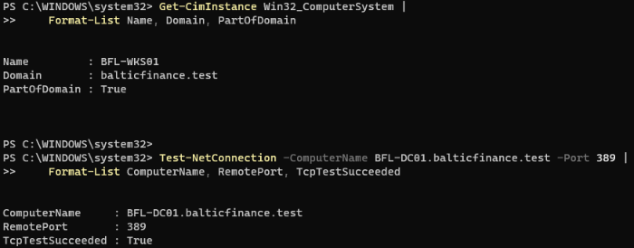
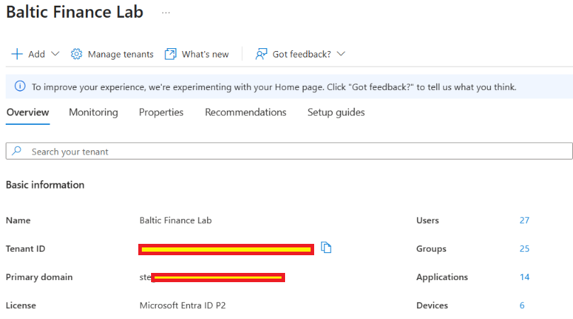
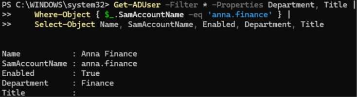
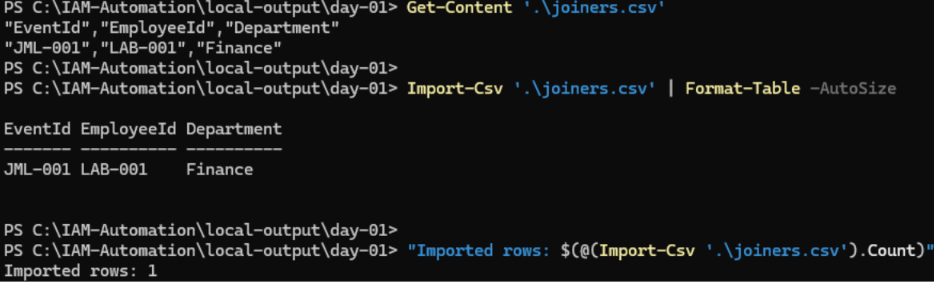

# Day 01 — Lab setup and PowerShell basics evidence

Four uploaded screenshots support the recorded result checks. Record updated 2026-11-11.

[Lab record](../../docs/day-01.md) · [Test results](../../tests/day-01.md)

## 01 — Domain membership and controller connectivity

`BFL-WKS01` reports domain `balticfinance.test` and `PartOfDomain=True`. The TCP connection test to `BFL-DC01.balticfinance.test:389` succeeds.

## 02 — Tenant and displayed Entra license

The `Baltic Finance Lab` Overview shows `Microsoft Entra ID P2`. The tenant ID and primary domain are redacted.

## 03 — AD PowerShell pipeline

The command pipes `Get-ADUser` output through `Where-Object` and `Select-Object`. The selected `anna.finance` account is enabled and belongs to Finance. Its Title field is empty.

## 04 — Synthetic CSV contents and reimport

`Get-Content` displays the CSV headers and the `JML-001 / LAB-001 / Finance` record. `Import-Csv` returns that row as a table, and the final count is `Imported rows: 1`.

