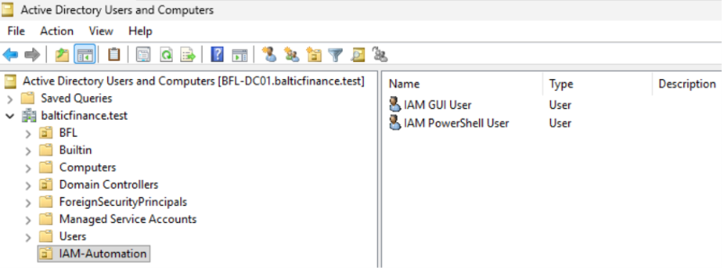
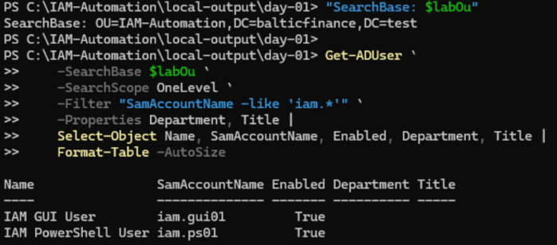
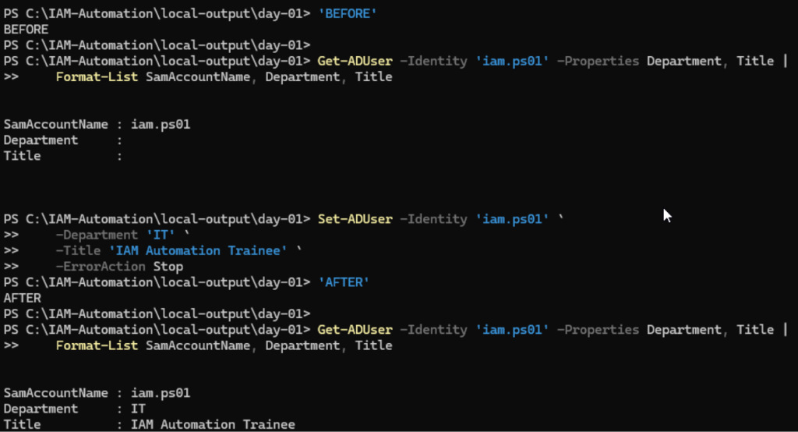

# Day 02 — Active Directory user management evidence

Three uploaded screenshots support the recorded result checks. Record updated 2026-11-11.

[Lab record](../../docs/day-02.md) · [Test results](../../tests/day-02.md) · [Saved PowerShell example](../../scripts/day-02-user-attributes.ps1)

## 01 — Dedicated OU and user objects

Active Directory Users and Computers is connected to `BFL-DC01.balticfinance.test`. The selected `IAM-Automation` OU contains `IAM GUI User` and `IAM PowerShell User`.

## 02 — OU-scoped PowerShell query

The displayed SearchBase is `OU=IAM-Automation,DC=balticfinance,DC=test`. The query uses `OneLevel` and the `iam.*` login filter. It returns `iam.gui01` and `iam.ps01`, both enabled, with empty Department and Title fields at this point in the exercise.

## 03 — Attribute values before and after the update

The BEFORE read shows empty Department and Title for `iam.ps01`. The captured `Set-ADUser` command sets IT and IAM Automation Trainee, and the independent AFTER read returns those values for the same account.

