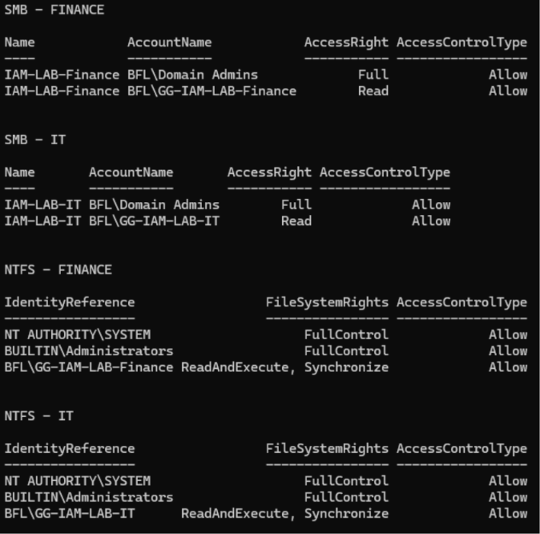
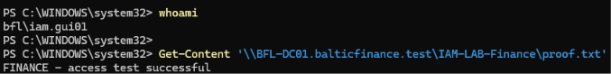
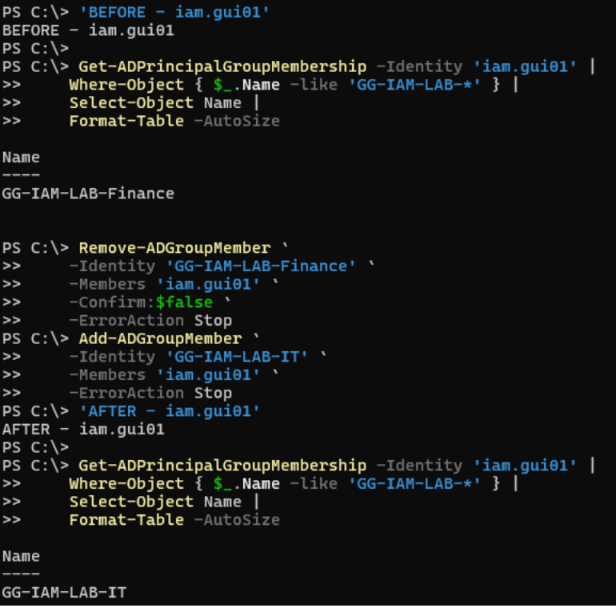
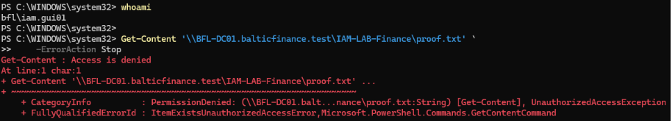
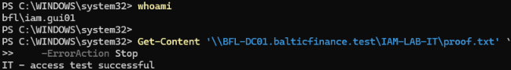
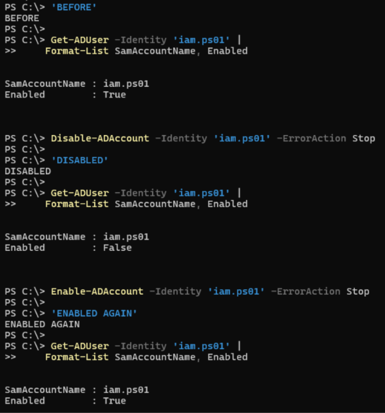

# Day 03 — Active Directory groups and effective access evidence

Six uploaded screenshots support the five recorded result checks. Record updated 2026-11-11.

[Lab record](../../docs/day-03.md) · [Test results](../../tests/day-03.md) · [Membership example](../../scripts/day-03-group-memberships.ps1) · [Console excerpts](console-excerpts.md)

## 01 — SMB and NTFS permissions

The report lists Finance and IT separately. Each share grants Domain Admins Full and its department group Read. Each corresponding NTFS table grants SYSTEM and Administrators FullControl and its department group ReadAndExecute with Synchronize. All shown entries are Allow.

## 02 — Finance read before transfer

`whoami` identifies `bfl\iam.gui01`. Reading the Finance proof file through its UNC path returns `FINANCE - access test successful`.

## 03 — Memberships before and after transfer

The filtered BEFORE view shows Finance for `iam.gui01`. The captured Remove-ADGroupMember and Add-ADGroupMember commands are followed by an AFTER view showing IT.

## 04 — Finance read denied after transfer

The session identifies `bfl\iam.gui01` and attempts the same Finance proof-file path. PowerShell returns `Access is denied` with PermissionDenied and UnauthorizedAccessException.

## 05 — IT read allowed after transfer

The session identifies `bfl\iam.gui01`. Reading the IT proof file returns `IT - access test successful`.

## 06 — Separate account disabled and re-enabled

The capture shows `iam.ps01` with Enabled=True, then False after Disable-ADAccount, then True after Enable-ADAccount.

