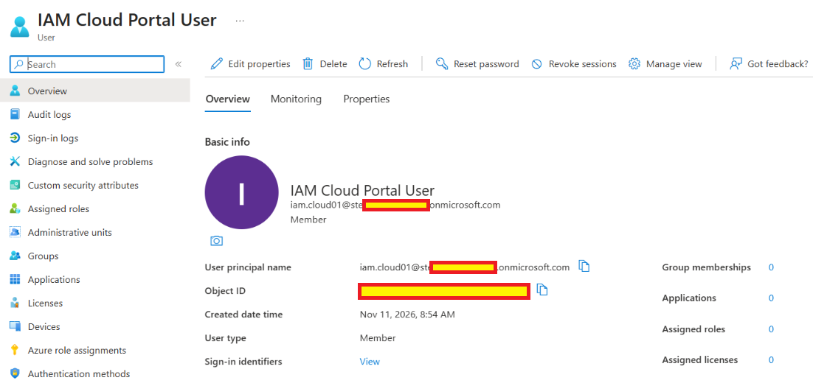
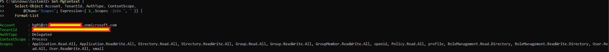
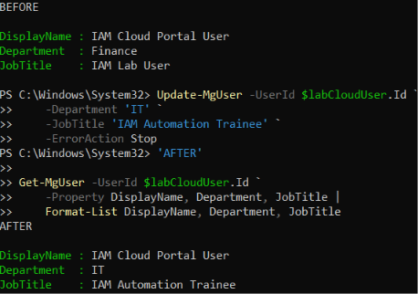
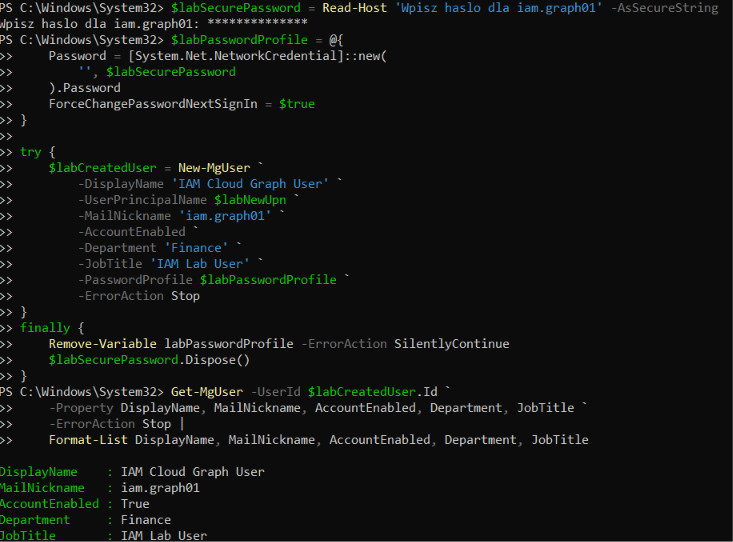

# Day 04 — Entra ID user management with Microsoft Graph evidence

Four uploaded screenshots support the three recorded result checks. Record updated 2026-11-11.

[Lab record](../../docs/day-04.md) · [Test results](../../tests/day-04.md) · [Permissions record](../../docs/permissions.md#day-04-recorded-graph-context)

## 01 — Portal-created user

The Entra user Overview shows IAM Cloud Portal User, the iam.cloud01 login prefix and Member user type. The object ID and part of the domain are redacted.

## 02 — Delegated Graph context

Get-MgContext shows AuthType=Delegated and ContextScope=Process. The account has the visible alias bg01. The domain and tenant ID are redacted. The scope list contains User.ReadWrite.All together with additional application, directory, group, policy and role-management scopes.

## 03 — Attributes before and after Graph update

The BEFORE result shows Department=Finance and JobTitle=IAM Lab User. Update-MgUser sets IT and IAM Automation Trainee, and the subsequent Get-MgUser read returns those values for IAM Cloud Portal User.

## 04 — User creation through Graph

The capture shows masked password input, the password-profile setup, New-MgUser and a subsequent Get-MgUser read using the returned object ID. The result is IAM Cloud Graph User, alias iam.graph01, AccountEnabled=True, Department=Finance and JobTitle=IAM Lab User.

