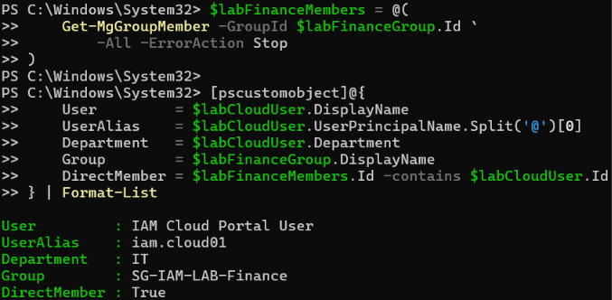
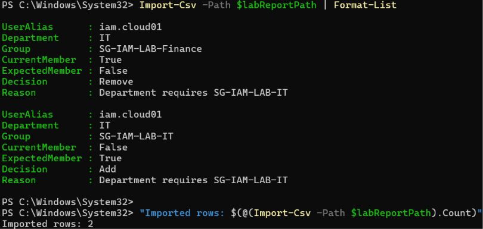
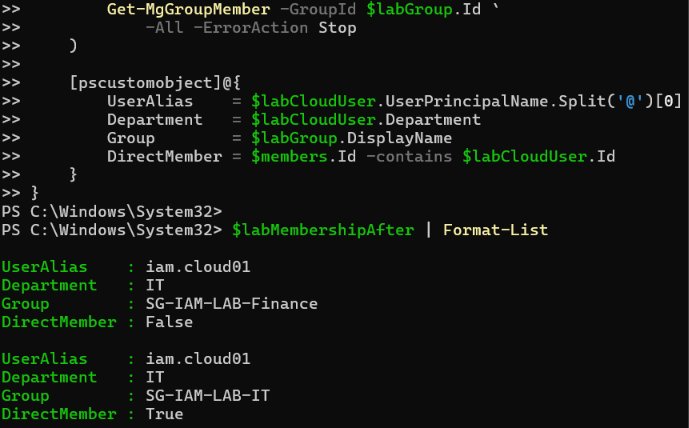

# Day 05 — Entra security groups and manual access review evidence

Three uploaded screenshots and two CSV files support the three recorded result checks. Record updated 2026-11-11.

[Lab record](../../docs/day-05.md) · [Test results](../../tests/day-05.md) · [Review CSV](../../samples/membership-review.csv) · [Final-state CSV](../../samples/membership-after.csv)

## 01 — Membership before review

The result is built from a fresh Get-MgGroupMember read. It identifies IAM Cloud Portal User / iam.cloud01, Department=IT, Group=SG-IAM-LAB-Finance and DirectMember=True.

## 02 — Review report and proposed corrections

Import-Csv returns two rows and the final count is Imported rows: 2. Finance has CurrentMember=True, ExpectedMember=False and Decision=Remove. IT has CurrentMember=False, ExpectedMember=True and Decision=Add. Both rows identify the reason Department requires SG-IAM-LAB-IT.

## 03 — Direct memberships after correction

The captured query reads each group's direct members. Both results identify iam.cloud01 and Department=IT. Finance DirectMember=False and IT DirectMember=True.

## CSV artifacts

| File | Recorded contents |
| --- | --- |
| [membership-review.csv](../../samples/membership-review.csv) | Two pre-correction rows with the expected memberships, decisions and reason shown in screenshot 02. |
| [membership-after.csv](../../samples/membership-after.csv) | Two final-state rows matching screenshot 03. |
