# Day 06 — Scoped Cloud Sync evidence

Seventeen uploaded screenshots record discovery, scope diagnosis and correction, user creation, anchor comparison and department propagation. Record updated 2026-11-11.

[Lab record](../../docs/day-06.md) · [Test results](../../tests/day-06.md)

The owner performed the actions. This set records provision on demand; the initial Cloud Sync overview is Disabled.

## Environment discovery

### 01 — Connect Sync discovery

The initial Connect Sync view displays Enabled, Last sync=More than 1 day ago and Password Hash Sync=Enabled. The subsequent screenshots identify Cloud Sync as the engine used for this exercise.

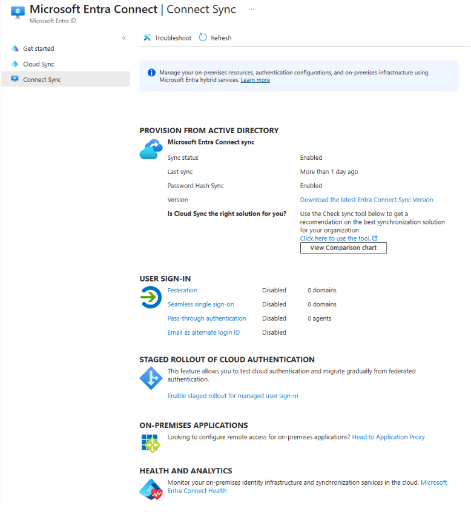

### 02 — Local Cloud Sync service

BFL-DC01 and BFL\\Administrator are visible. AADConnectProvisioningAgent is Running. This query captures the provisioning-agent service.

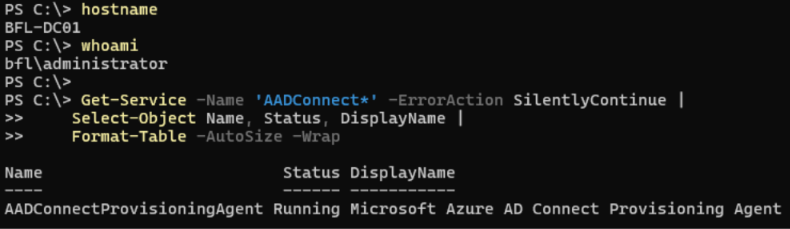

### 03 — Registered agent

The Cloud Sync Agents page lists BFL-DC01.balticfinance.test with status active. The external IP is redacted.

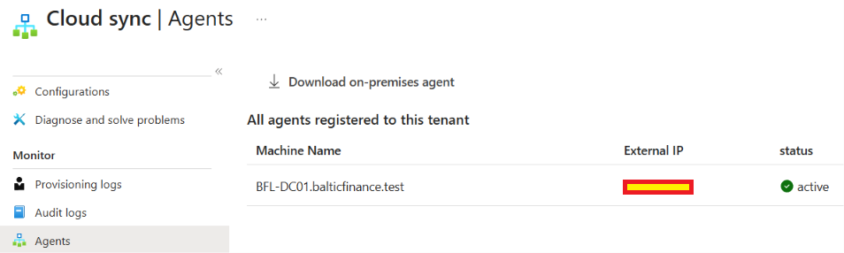

### 04 — Initial Cloud Sync overview

The balticfinance.test configuration shows Disabled, Password hash sync=Enabled and scheduled-cycle fields Not started / Never. Job identifiers are redacted.

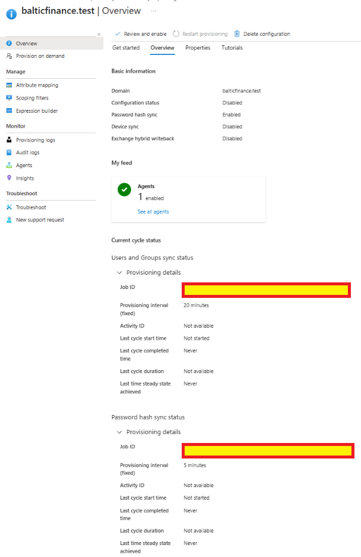

### 05 — Initial selected-group scope

Sync selected security groups is selected. The entries are GG-Finance, GG-IT and GG-Security.

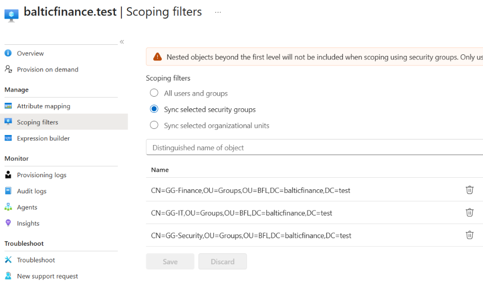

## Test identity and scope correction

### 06 — Dedicated OU and user

ADUC shows IAM Sync User in IAM-Automation → IAM-Sync, with the Day 06 Cloud Sync test description.

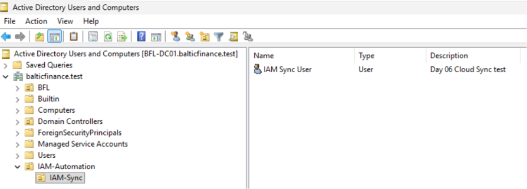

### 07 — AD baseline

The AD read shows iam.sync01 enabled, Department=Finance, Title=IAM Sync Lab User and the dedicated DN. ms-DS-ConsistencyGuid is empty. The tenant-domain portion of the UPN and ObjectGUID value are masked.

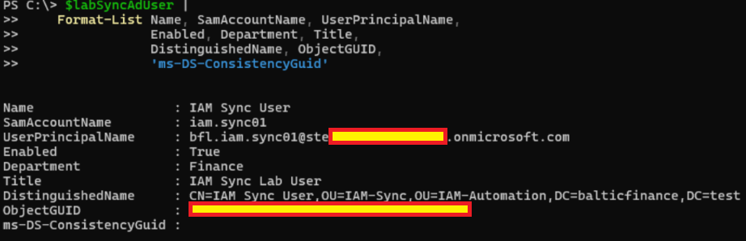

### 08 — Initial skipped result

The first request ends with Object was skipped. Processing details report SkipReason=JoinNotFound; the user identifier is masked.

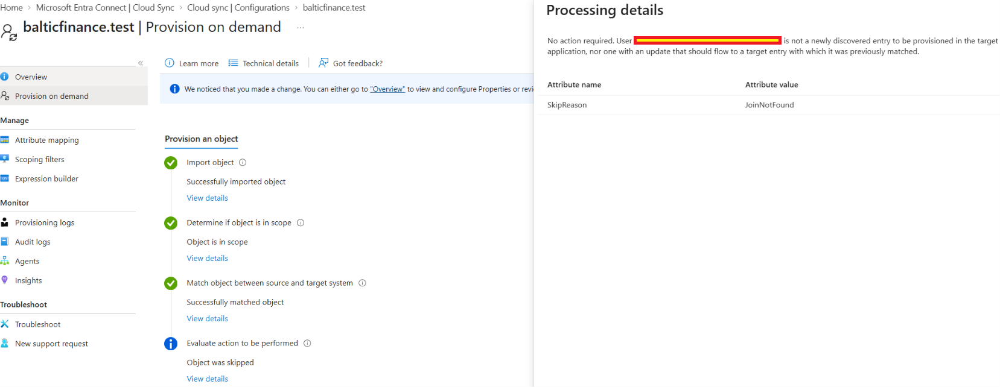

### 09 — Detailed scope evaluation

Scoping details report Active in the source system=True and Scoping filter evaluation passed=False, despite the summary caption Object is in scope.

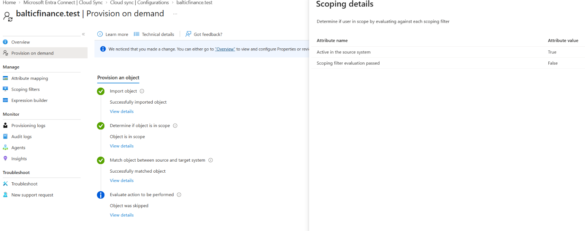

### 10 — Dedicated group and direct membership

The captured commands create GG-IAM-LAB-Sync as Global/Security in the test OU, add the test user and read one direct member: IAM Sync User / iam.sync01.

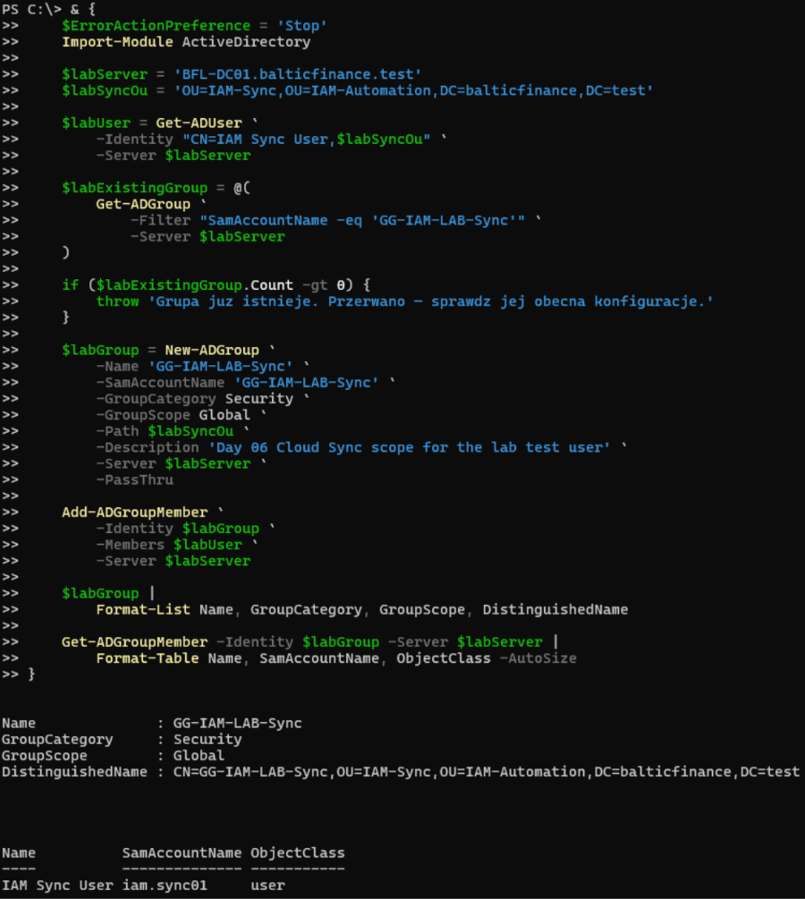

### 11 — Corrected scope

The selected-security-group list contains all three original groups plus the DN of GG-IAM-LAB-Sync.

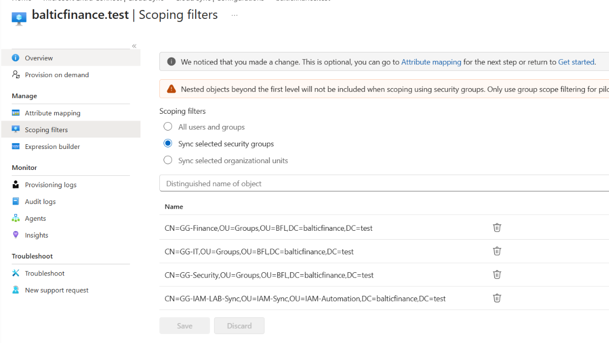

### 12 — Creation after correction

The repeat request reports successful creation in Microsoft Entra ID. Export details identify IAM Sync User, AccountEnabled=True and Department=Finance. The cloud domain is masked.

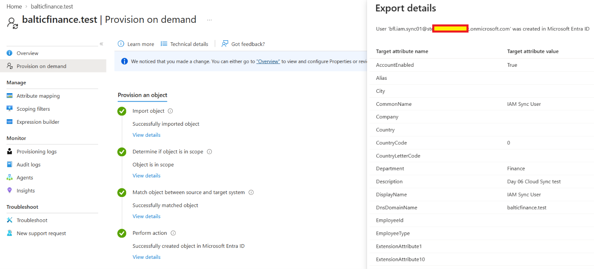

## Graph verification and attribute propagation

### 13 — Independent Graph baseline

Get-MgUser requires exactly one matching account. Output shows bfl.iam.sync01, Finance, AccountEnabled=True, JobTitle=IAM Sync Lab User, OnPremisesSyncEnabled=True, the expected AD SAM name and DN, and ImmutableIdPresent=True.

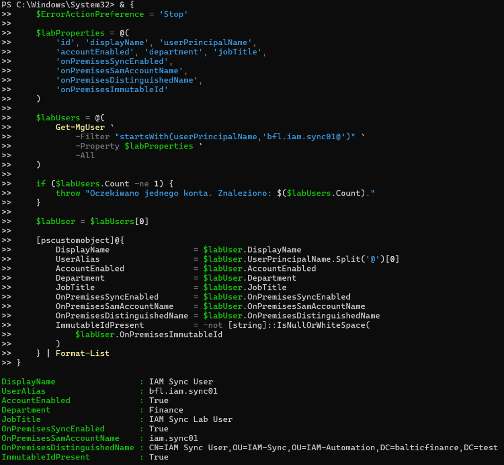

### 14 — Anchor comparison

The comparison validates the supplied attribute/Base64 input and reads Graph again. Output records SourceAnchorAttribute=objectGUID and True for SAM-name, DN and ordinal Base64-anchor comparisons. The raw input came from the guided AD calculation.

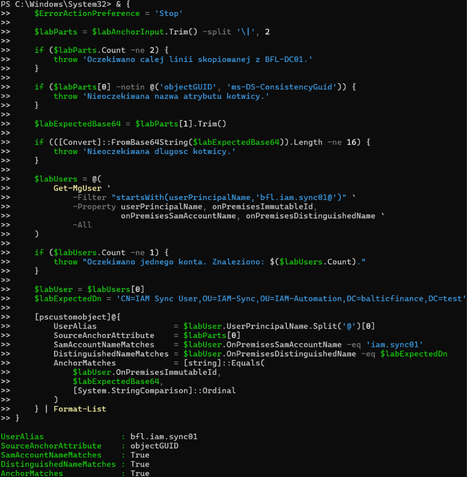

### 15 — AD department before and after

Set-ADUser targets the dedicated user DN on BFL-DC01. Fresh reads show Department=Finance before and IT after, with Title=IAM Sync Lab User in both reads.

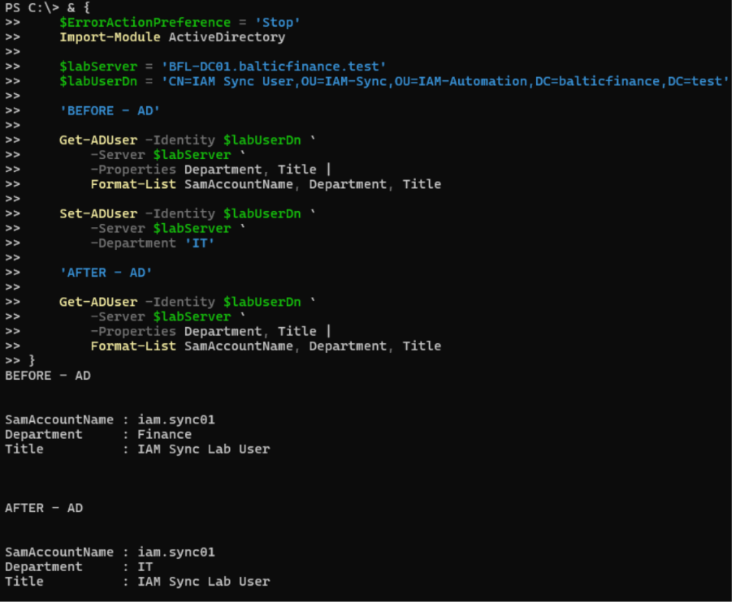

### 16 — Exported department update

Provision on demand reports successful update of the existing Entra user. Export details show Department=IT and AccountEnabled=True.

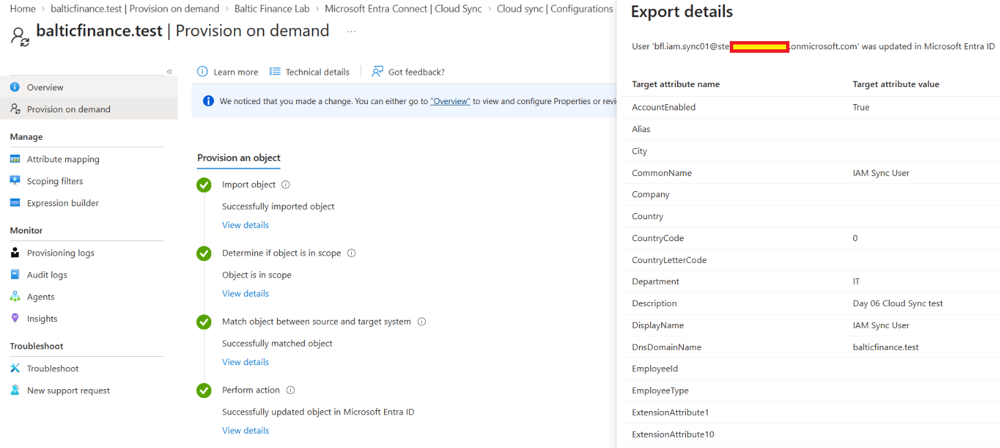

### 17 — Final Graph read

A fresh Get-MgUser query returns Department=IT, DepartmentMatchesExpected=True, AccountEnabled=True, OnPremisesSyncEnabled=True, the expected AD SAM name and DN, and ImmutableIdPresent=True.

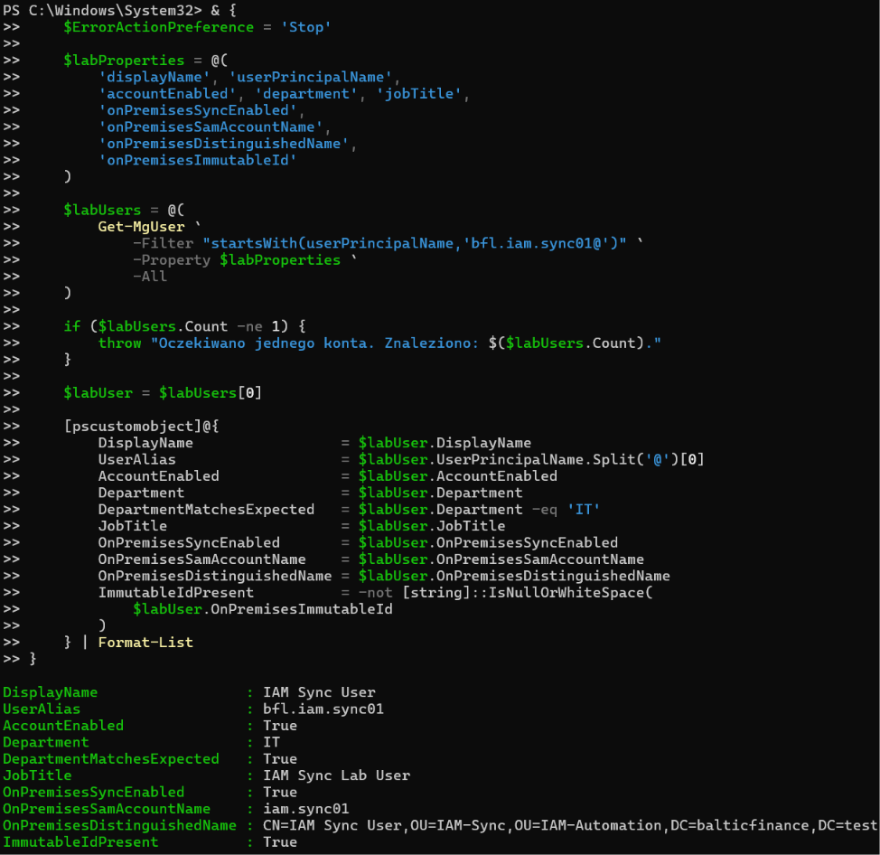

## Coverage

The skipped attempt and detailed False evaluation are retained alongside the successful retry. Anchor equality is recorded before the department change. The final Graph read records the updated department and ImmutableId presence. Recurring-cycle execution, password propagation and user sign-in were outside this evidence set.
