# Day 07 — Joiner–Mover–Leaver automation evidence

[Lab record](../../docs/day-07.md) · [Test record](../../tests/day-07.md) · [Source](../../scripts/Invoke-IamLifecycle.ps1)

Sixteen screenshots record the setup, previews, real execution, independent directory reads and local CSV audit views. The account is iam.lab001 / LAB-001 in the dedicated JML OU.

| File | Recorded observation |
| --- | --- |
| [01-lifecycle-environment.png](01-lifecycle-environment.png) | Execution host, operator, PowerShell version, parent OU, managed group DNs and zero identity collisions. |
| [02-lifecycle-ou.png](02-lifecycle-ou.png) | The dedicated empty JML OU beside the existing IAM-Sync OU. |
| [03-lifecycle-input-files.png](03-lifecycle-input-files.png) | Local configuration, access matrix and three synthetic lifecycle events. |
| [04-lifecycle-preview.png](04-lifecycle-preview.png) | Version 0.1.0 default Joiner preview: two planned operations and unchanged managed state. |
| [05-lifecycle-whatif.png](05-lifecycle-whatif.png) | Version 0.2.0 Apply with WhatIf: two planned, zero applied, account absent and unchanged managed state. |
| [06-lifecycle-joiner-applied.png](06-lifecycle-joiner-applied.png) | Joiner Apply completed: account created and Finance membership granted. |
| [07-lifecycle-joiner-verification.png](07-lifecycle-joiner-verification.png) | Independent AD read: Enabled=True, Finance department, Finance=True, IT=False. |
| [08-lifecycle-joiner-log.png](08-lifecycle-joiner-log.png) | Joiner audit: two Applied steps, zero Failed and RunCompleted=True. |
| [09-lifecycle-mover-preview.png](09-lifecycle-mover-preview.png) | Mover preview: department update, Finance removal and IT addition; state unchanged. |
| [10-lifecycle-mover-applied.png](10-lifecycle-mover-applied.png) | Mover Apply completed: three applied operations and no remaining operations. |
| [11-lifecycle-mover-verification.png](11-lifecycle-mover-verification.png) | Independent AD read: Enabled=True, IT department, Finance=False, IT=True. |
| [12-lifecycle-mover-log.png](12-lifecycle-mover-log.png) | Mover audit: department update, old-access removal and new-access grant in order; three Applied and zero Failed. |
| [13-lifecycle-leaver-preview.png](13-lifecycle-leaver-preview.png) | Leaver preview: disable account then remove IT membership; state unchanged. |
| [14-lifecycle-leaver-applied.png](14-lifecycle-leaver-applied.png) | Leaver Apply completed: account disabled, IT removed and no remaining operations. |
| [15-lifecycle-leaver-verification.png](15-lifecycle-leaver-verification.png) | Independent AD read: Enabled=False, Department=IT, Finance=False, IT=False. |
| [16-lifecycle-leaver-log.png](16-lifecycle-leaver-log.png) | Leaver audit: disable before group removal; two Applied, zero Failed and RunCompleted=True. |

The first preview uses version 0.1.0; WhatIf and the live lifecycle use version 0.2.0. The live Apply counts are 2 / 3 / 2, with zero failed audit records. Raw audit CSV files stay in local-output. These images establish AD account and direct-group state; fresh workstation access and disabled-account logon tests remain in Day 08.

## Captured results

### 01 · Execution host, operator, PowerShell version, parent OU, managed group DNs and zero identity collisions.

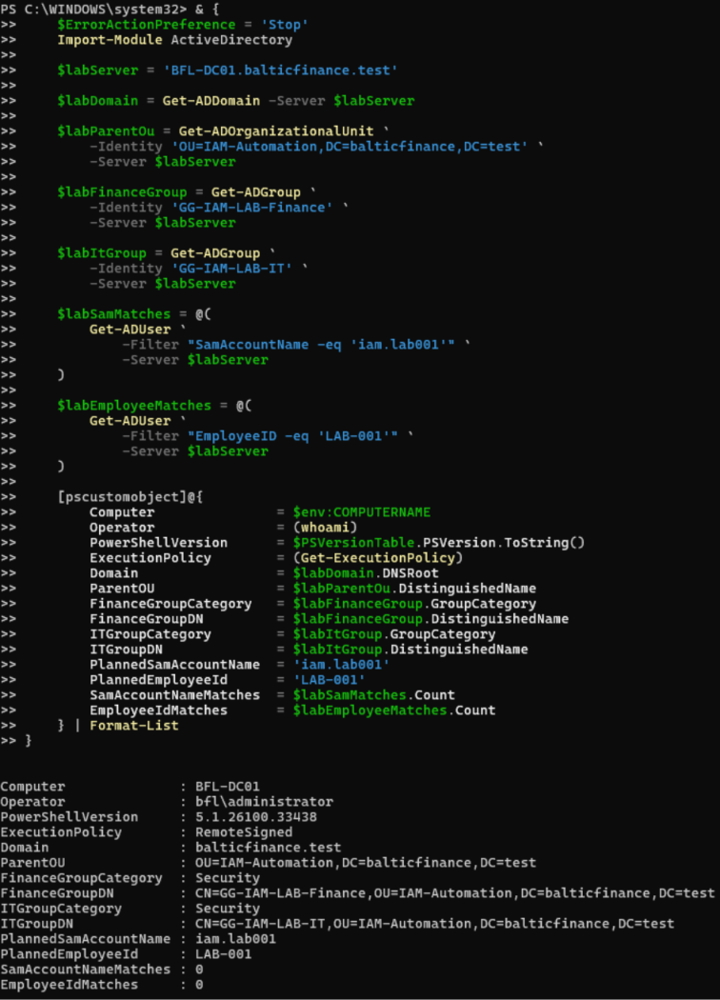

### 02 · The dedicated empty JML OU beside the existing IAM-Sync OU.

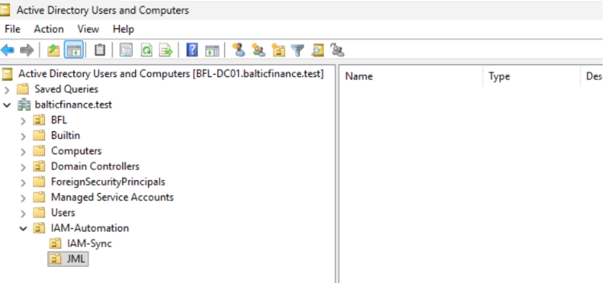

### 03 · Local configuration, access matrix and three synthetic lifecycle events.

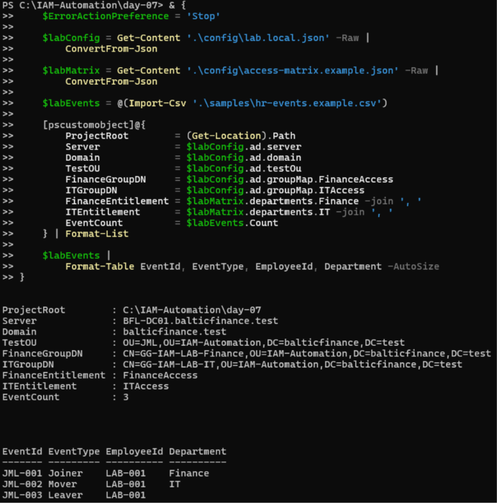

### 04 · Version 0.1.0 default Joiner preview: two planned operations and unchanged managed state.

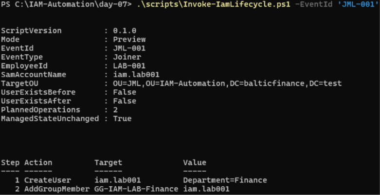

### 05 · Version 0.2.0 Apply with WhatIf: two planned, zero applied, account absent and unchanged managed state.

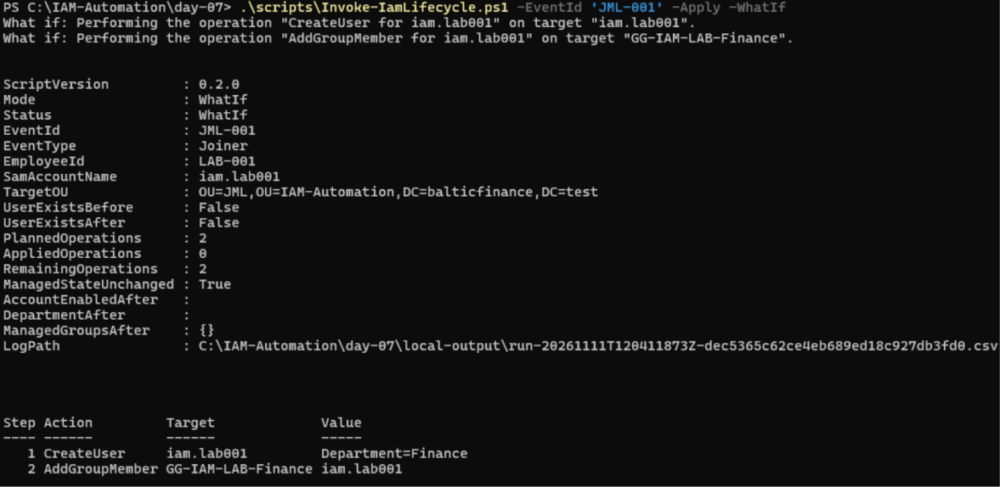

### 06 · Joiner Apply completed: account created and Finance membership granted.

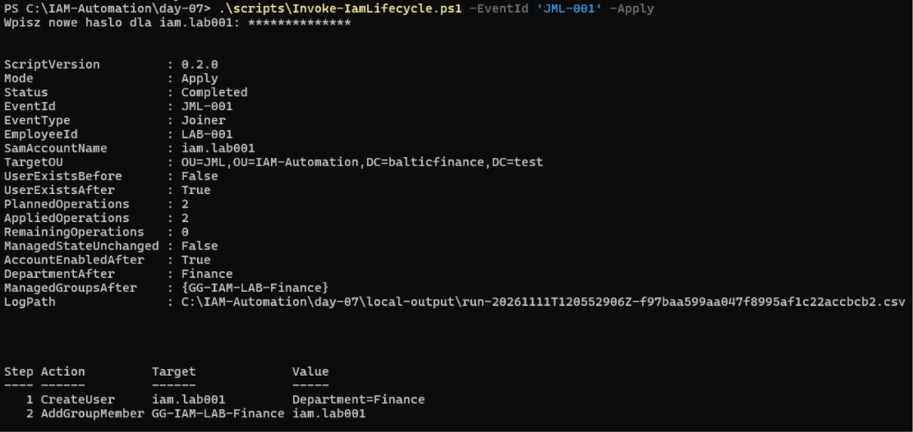

### 07 · Independent AD read: Enabled=True, Finance department, Finance=True, IT=False.

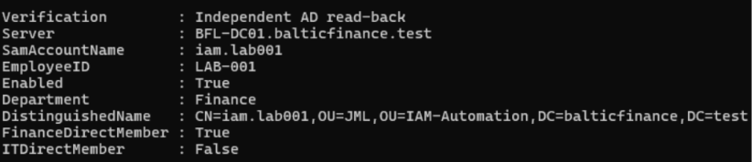

### 08 · Joiner audit: two Applied steps, zero Failed and RunCompleted=True.

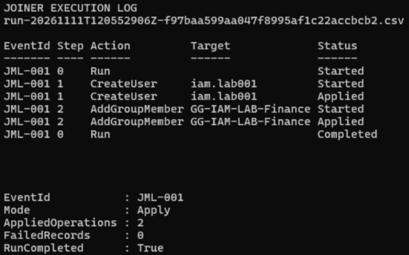

### 09 · Mover preview: department update, Finance removal and IT addition; state unchanged.

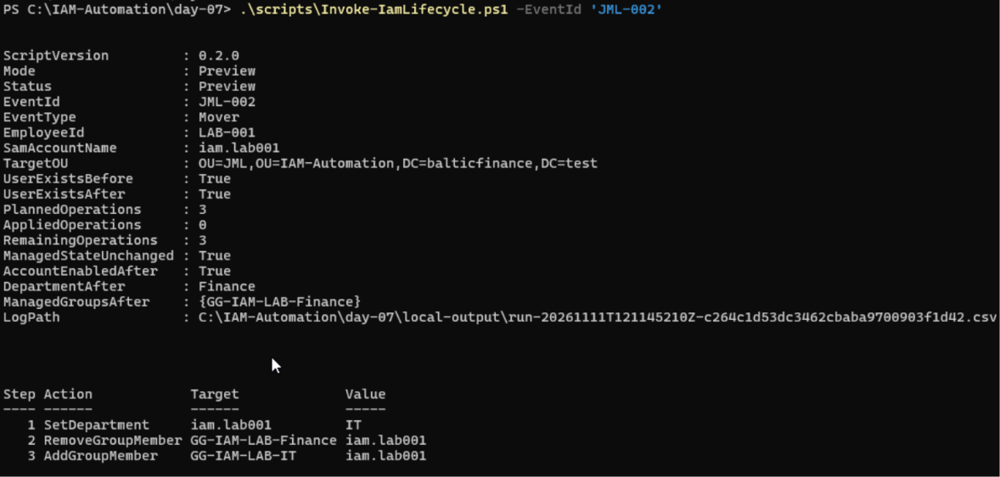

### 10 · Mover Apply completed: three applied operations and no remaining operations.

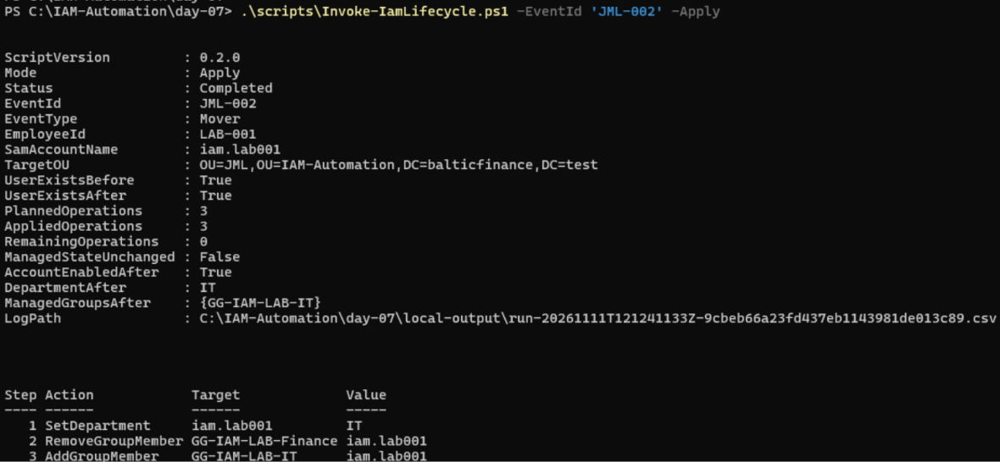

### 11 · Independent AD read: Enabled=True, IT department, Finance=False, IT=True.

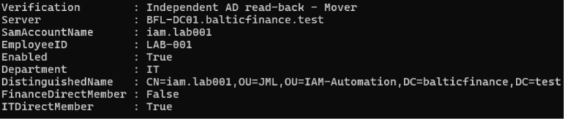

### 12 · Mover audit: department update, old-access removal and new-access grant in order; three Applied and zero Failed.

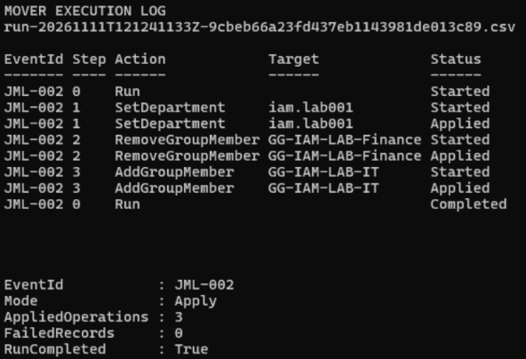

### 13 · Leaver preview: disable account then remove IT membership; state unchanged.

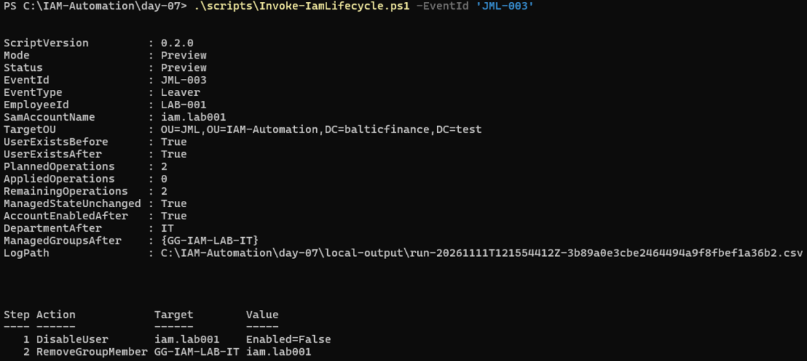

### 14 · Leaver Apply completed: account disabled, IT removed and no remaining operations.

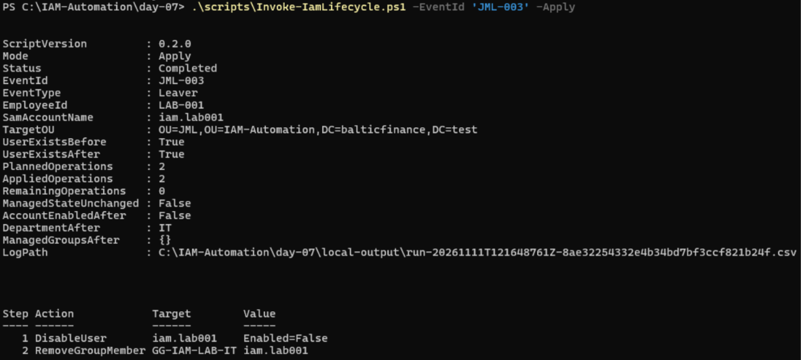

### 15 · Independent AD read: Enabled=False, Department=IT, Finance=False, IT=False.

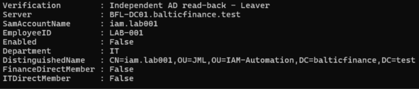

### 16 · Leaver audit: disable before group removal; two Applied, zero Failed and RunCompleted=True.

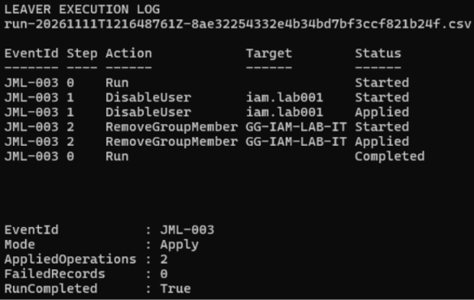
