# Day 08 — Capstone, Pester and portfolio evidence

[Lab record](../../docs/day-08.md) · [Test results](../../tests/day-08.md) · [CI result record](ci-summary.md)

Twenty-six screenshots record the fresh LAB-002 lifecycle, independent WhatIf checks, no-op repeats, controlled recovery, real Windows access/sign-in results and the separate LAB-003 scope test. The lifecycle version is 0.2.0.

| File | Recorded observation |
| --- | --- |
| [01-capstone-environment.png](01-capstone-environment.png) | Preflight: correct host/operator/runtime, available project files, no LAB-002 collision and both test shares/proof files. |
| [02-capstone-input-files.png](02-capstone-input-files.png) | Separate Day 08 workspace and three validated LAB-002 lifecycle events. |
| [03-capstone-whatif.png](03-capstone-whatif.png) | Joiner WhatIf: two planned, zero applied and no account creation. |
| [04-capstone-whatif-state-preserved.png](04-capstone-whatif-state-preserved.png) | Independent WhatIf before/after read: zero matching accounts and unchanged group identities/direct memberships. |
| [05-capstone-joiner-applied.png](05-capstone-joiner-applied.png) | Joiner Apply: two operations completed, enabled account and Finance membership. |
| [06-capstone-joiner-finance-access.png](06-capstone-joiner-finance-access.png) | BFL-WKS01 / bfl\iam.lab002 reads the Finance proof file successfully. |
| [07-capstone-joiner-repeat-noop.png](07-capstone-joiner-repeat-noop.png) | Same-stage Joiner repeat: NoChange, zero operations and unchanged managed state. |
| [08-capstone-mover-preview.png](08-capstone-mover-preview.png) | Mover preview: department update, Finance removal and IT grant in order. |
| [09-capstone-mover-injected-failure.png](09-capstone-mover-injected-failure.png) | Deliberate Mover exception after successful old-group removal. |
| [10-capstone-mover-partial-state.png](10-capstone-mover-partial-state.png) | Independent partial-state read: enabled, Department=IT, Finance=False and IT=False. |
| [11-capstone-mover-partial-log.png](11-capstone-mover-partial-log.png) | Partial audit: two Applied steps, Failed Run and no IT grant record. |
| [12-capstone-mover-recovery-preview.png](12-capstone-mover-recovery-preview.png) | Fresh recovery plan contains only the missing IT grant. |
| [13-capstone-mover-recovery-applied.png](13-capstone-mover-recovery-applied.png) | Recovery Apply completes one operation and leaves zero remaining operations. |
| [14-capstone-mover-finance-denied.png](14-capstone-mover-finance-denied.png) | Fresh-session Finance proof-file read returns PermissionDenied for bfl\iam.lab002. |
| [15-capstone-mover-it-access.png](15-capstone-mover-it-access.png) | The same client identity successfully reads the IT proof file. |
| [16-capstone-mover-repeat-noop.png](16-capstone-mover-repeat-noop.png) | Same-stage completed Mover repeat: NoChange and zero operations. |
| [17-capstone-leaver-preview.png](17-capstone-leaver-preview.png) | Leaver preview: disable account before removing IT membership. |
| [18-capstone-leaver-applied.png](18-capstone-leaver-applied.png) | Leaver Apply: two operations completed, account disabled and managed memberships empty. |
| [19-capstone-leaver-domain-logon-denied.png](19-capstone-leaver-domain-logon-denied.png) | Windows sign-in screen for Marek Example reports that the account is disabled. |
| [20-capstone-leaver-verification.png](20-capstone-leaver-verification.png) | Independent AD read ties Marek Example to LAB-002 and confirms disabled state and neither membership. |
| [21-capstone-leaver-repeat-noop.png](21-capstone-leaver-repeat-noop.png) | Same-stage Leaver repeat: NoChange with the account still disabled. |
| [22-capstone-out-of-scope-fixture.png](22-capstone-out-of-scope-fixture.png) | Disabled LAB-003 fixture outside JML, Finance membership present and baseline saved. |
| [23-capstone-out-of-scope-blocked.png](23-capstone-out-of-scope-blocked.png) | Apply for the outside-OU fixture is rejected by the exact account-DN boundary. |
| [24-capstone-out-of-scope-state-preserved.png](24-capstone-out-of-scope-state-preserved.png) | Independent state/revision unchanged; Finance retained; zero started write steps and the expected Failed Run. |
| [25-capstone-scope-fixture-cleanup.png](25-capstone-scope-fixture-cleanup.png) | Separate manual fixture cleanup: LAB-003 remains disabled, Finance=False and IT=False. |
| [26-capstone-pester-ci-passed.png](26-capstone-pester-ci-passed.png) | Successful GitHub Actions job with detailed lifecycle results and 44 Pester tests passed, zero failed. |

The sign-in result in image 19 shows the display name; image 20 independently ties it to iam.lab002 / LAB-002. Image 25 is manual cleanup after the rejected request, separate from the unchanged-state result in image 24. Raw VM CSV/JSON artifacts stay in local-output. The CI image records the code-validation run linked in the CI result record.

## Captured results

### 01 · Preflight: correct host/operator/runtime, available project files, no LAB-002 collision and both test shares/proof files.

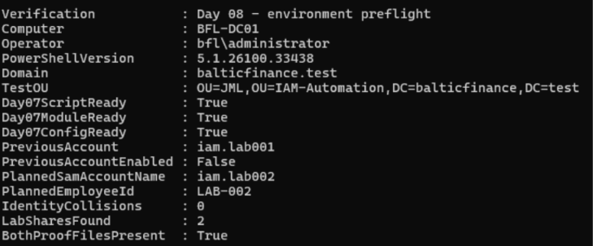

### 02 · Separate Day 08 workspace and three validated LAB-002 lifecycle events.

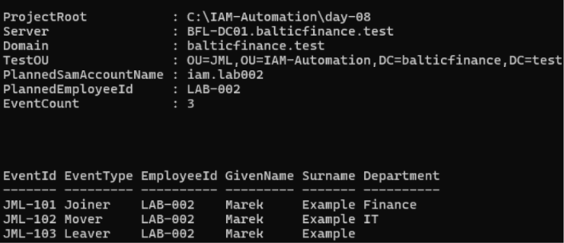

### 03 · Joiner WhatIf: two planned, zero applied and no account creation.

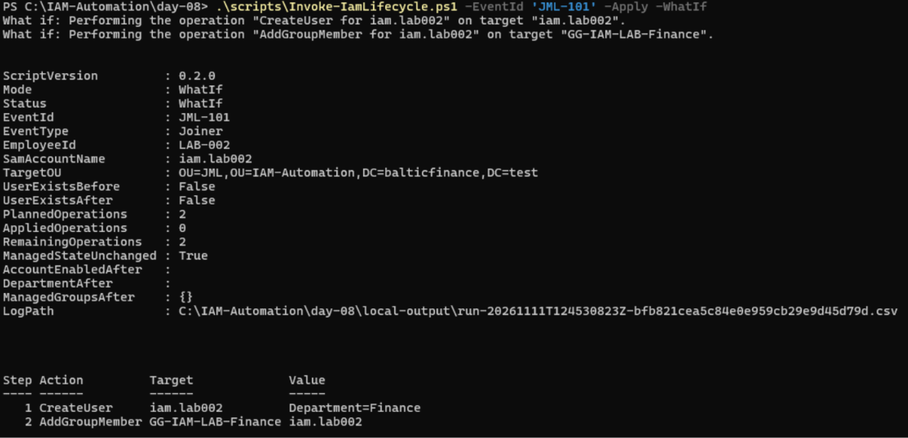

### 04 · Independent WhatIf before/after read: zero matching accounts and unchanged group identities/direct memberships.

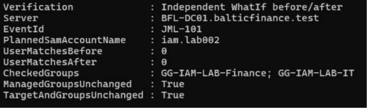

### 05 · Joiner Apply: two operations completed, enabled account and Finance membership.

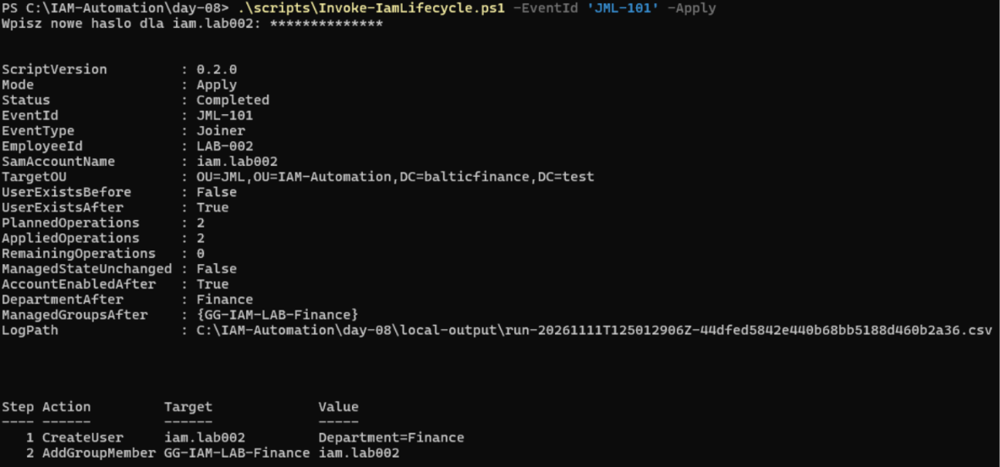

### 06 · BFL-WKS01 / bfl\iam.lab002 reads the Finance proof file successfully.

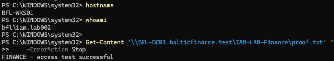

### 07 · Same-stage Joiner repeat: NoChange, zero operations and unchanged managed state.

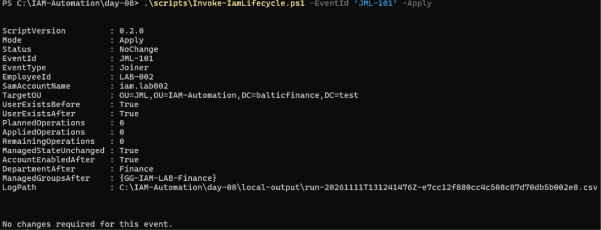

### 08 · Mover preview: department update, Finance removal and IT grant in order.

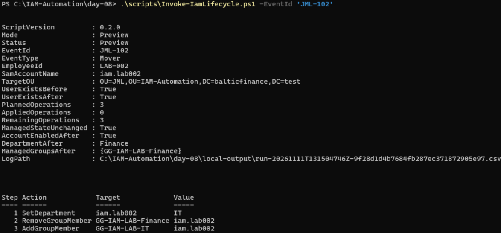

### 09 · Deliberate Mover exception after successful old-group removal.

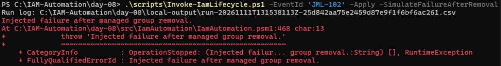

### 10 · Independent partial-state read: enabled, Department=IT, Finance=False and IT=False.

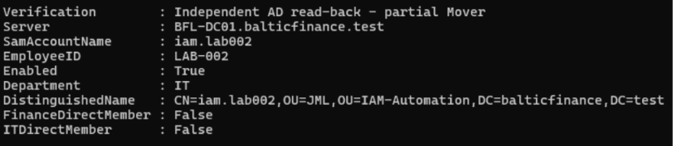

### 11 · Partial audit: two Applied steps, Failed Run and no IT grant record.

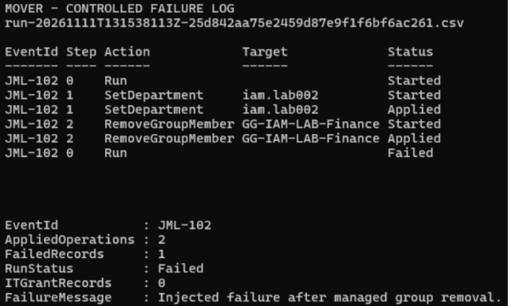

### 12 · Fresh recovery plan contains only the missing IT grant.

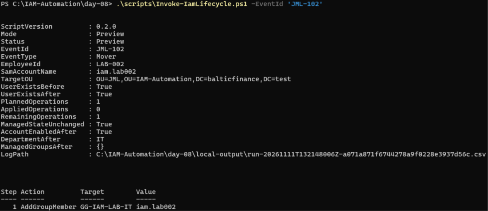

### 13 · Recovery Apply completes one operation and leaves zero remaining operations.

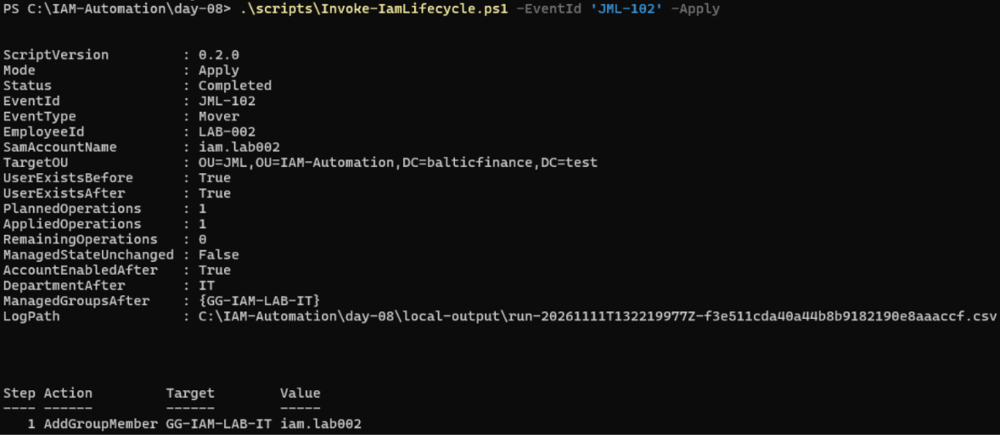

### 14 · Fresh-session Finance proof-file read returns PermissionDenied for bfl\iam.lab002.

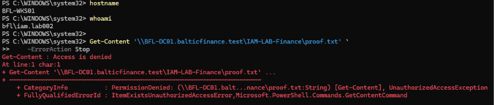

### 15 · The same client identity successfully reads the IT proof file.

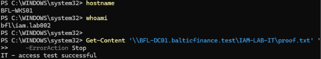

### 16 · Same-stage completed Mover repeat: NoChange and zero operations.

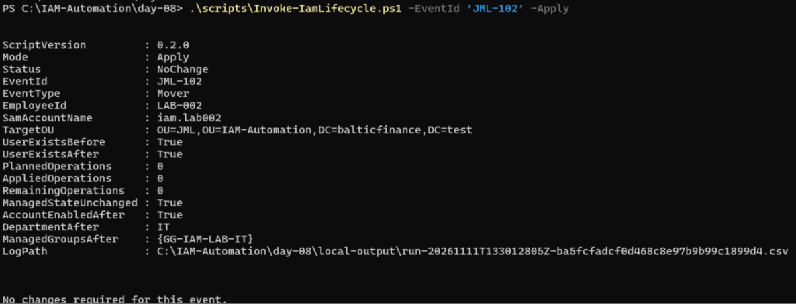

### 17 · Leaver preview: disable account before removing IT membership.

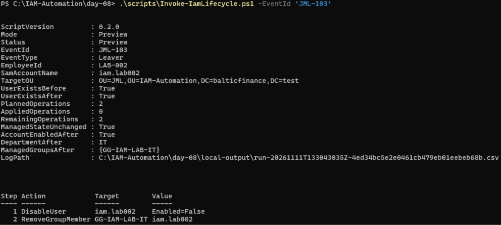

### 18 · Leaver Apply: two operations completed, account disabled and managed memberships empty.

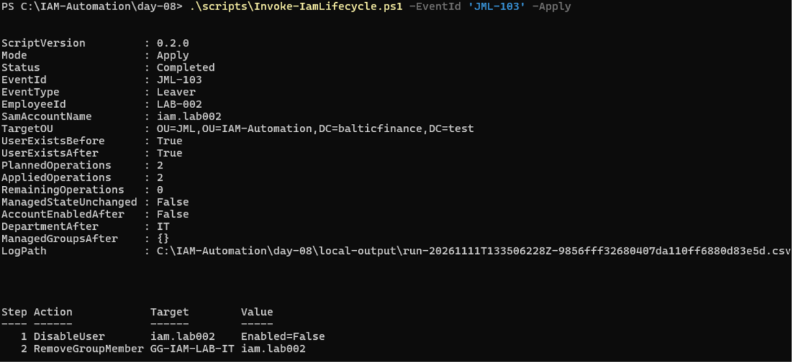

### 19 · Windows sign-in screen for Marek Example reports that the account is disabled.

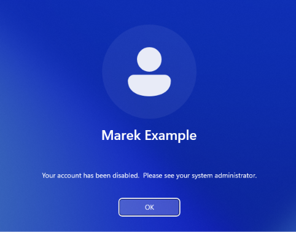

### 20 · Independent AD read ties Marek Example to LAB-002 and confirms disabled state and neither membership.

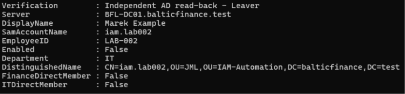

### 21 · Same-stage Leaver repeat: NoChange with the account still disabled.

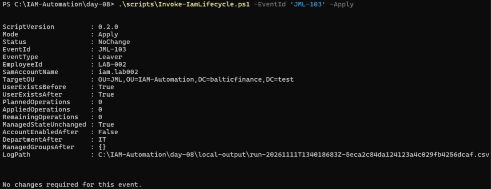

### 22 · Disabled LAB-003 fixture outside JML, Finance membership present and baseline saved.

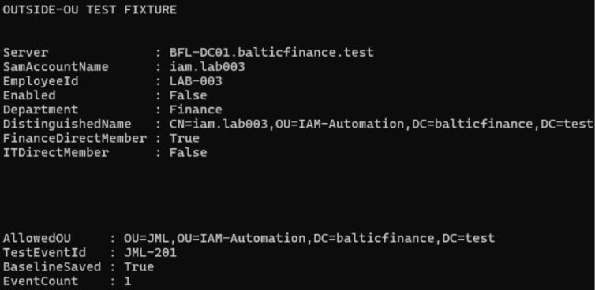

### 23 · Apply for the outside-OU fixture is rejected by the exact account-DN boundary.

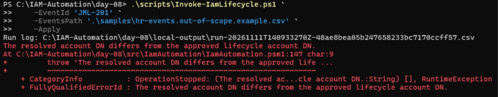

### 24 · Independent state/revision unchanged; Finance retained; zero started write steps and the expected Failed Run.

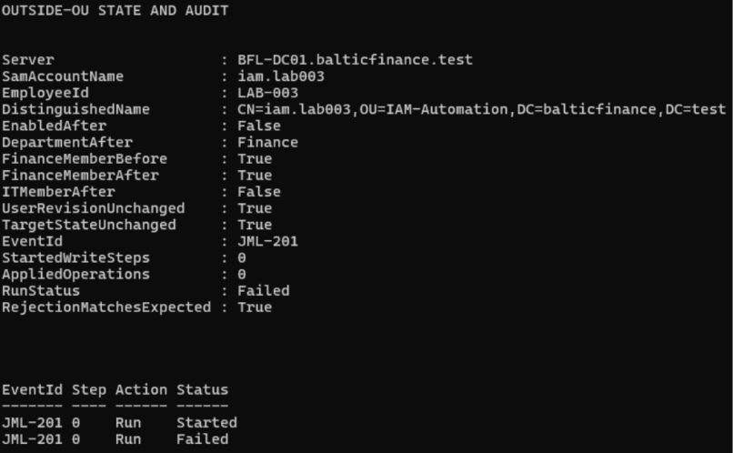

### 25 · Separate manual fixture cleanup: LAB-003 remains disabled, Finance=False and IT=False.

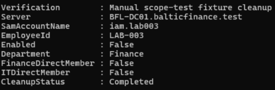

### 26 · Successful GitHub Actions job with detailed lifecycle results and 44 Pester tests passed, zero failed.

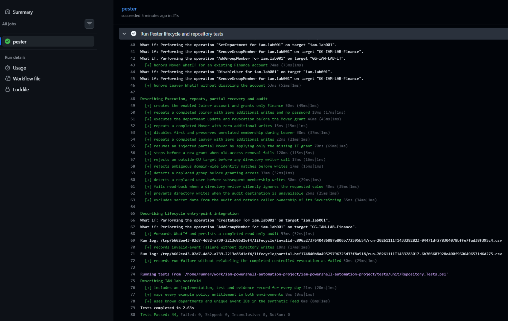
